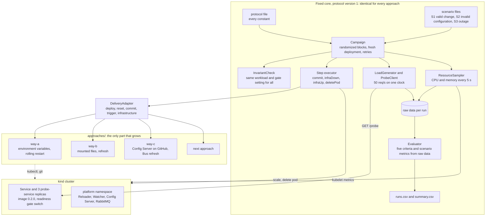
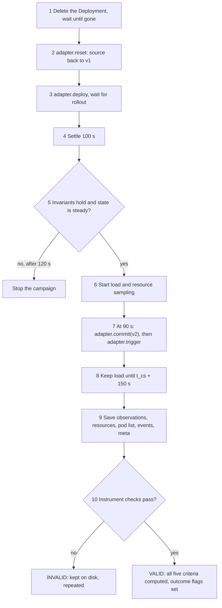

# Experiment plan: one fixed protocol for every delivery approach

Status: frozen on 2026-11-15 as protocol version 1. The design, the criteria,
the scenarios and the constants in this document do not change any more. A
change needs a new protocol version, a dated entry in
[DECISIONS.md](DECISIONS.md), and a new run of every approach. The build is
described in [claude-code-build-prompt.md](claude-code-build-prompt.md).

## Summary

- One protocol file holds every constant of the experiment: 3 replicas, 50 req/s,
  a v1 to v2 change, the phase lengths, the repetitions. No approach can override it.
- One run has a fixed timeline: reset, settle, warm-up, 60 s baseline, change,
  150 s observation. The five criteria are all computed from that one run.
- Three scenarios run on the same core: a valid change (S1), an invalid
  configuration followed by a fix (S2), and an outage of the delivery
  infrastructure (S3). A scenario is a file with timed steps that are the same
  for every approach.
- An approach is a folder with manifests and one descriptor file. The descriptor
  says how to deploy, how to reset the source to v1, how to commit v2, how to
  trigger activation, and which pods are its delivery infrastructure. Adding an
  approach adds a folder and changes no Java code.
- Collection and evaluation are separate. The runner writes raw data. The
  evaluator computes every metric from raw data only, so old runs can be
  re-evaluated when a metric is added.
- Runs are ordered in randomized blocks, and every run starts from a fresh
  deployment at v1.
- A run is excluded only when the instrument failed. Bad behaviour of an approach
  (failed requests, no convergence) is a result and stays in the data.

## How this plan is used

1. This file is the specification. Every symbol, formula, constant, step and
   validity rule is binding for the code.
2. The code is built in the order of [Build order](#build-order). A step starts
   only when the check of the step before it passes.
3. If the code cannot follow the plan, work stops and the reason is reported.
   The plan is not adjusted to fit the code, and no metric, scenario, approach
   or constant is added or removed during the build.
4. Every item under [Decisions](#decisions) becomes an entry in
   `docs/DECISIONS.md` (Problem / Rejected / Chosen / Cost) before any code.

## What exists today and what has to change

The inspection covered `tools/experiment-runner/`, `services/probe-service/`,
`deploy/`, `campaigns/`, the documents and the scenario 1 results of 2026-11-08.

Most of the instrument can stay as it is:

| Part | State |
|---|---|
| `RunnerClock`, `ProbeClient`, `Observation` | Keep. One clock, new connection per request, 2 s timeout |
| `LoadGenerator` | Keep. Open loop at a fixed rate, latency counted from the schedule. One small change, see row 9 below |
| `CoverageCheck` | Keep. Every pod observed at least once per second |
| `WindowDetector` and its tests | Keep the logic. Change the reference point and the validity rules, see rows 4 and 7 |
| `ResultWriter`, NDJSON plus meta file | Keep and extend |
| probe-service, one image for all approaches | Keep. Same binary everywhere, features switched by environment variables |
| kind cluster, topology spread, NodePort, `platform` namespace | Keep |

Eleven things stand between the current campaign and a fair comparison:

| # | Finding in the current code | Why it matters | Change |
|---|---|---|---|
| 1 | `campaigns/scenario-1.json` sets duration, settle and pause per Way (90, 30 and 150 s of observation) | Failed requests and latency are counted over windows of different length | Phase lengths live in the protocol only |
| 2 | `Campaign` runs all Way A runs, then all Way C, then all Way B | Drift of the machine over the evening is confounded with the approach | Randomized blocks |
| 3 | Versions are chained (`v<epoch+n>`) on a long-lived deployment | Way A pods are replaced in every run, Way B and C pods age over the campaign. Start states differ | Fresh deployment at v1 before every run, change to v2 |
| 4 | Propagation is counted from the end of the whole change command. In run r01 that command took 164 ms for Way A, 116 ms for Way B and 4 082 ms for Way C, because the Way C script also pushes to GitHub and calls `busrefresh` | Way C's trigger time is excluded while Reloader's and the Watcher's reaction times are included | Split the change into commit and trigger. T0 is the end of commit |
| 5 | Warm-up is 5 s and there is no baseline phase | Performance impact has nothing to be compared with | 30 s warm-up, 60 s baseline |
| 6 | `ClusterControl.patchCommand`, `versionKey`, namespace and deployment names are in the core | A new approach needs core changes | Adapter boundary |
| 7 | "New version never observed", "pod still on the old version" and "pod went back to the old version" make a run invalid | These are behaviours of the approach. Excluding them makes a weak approach look better | Separate instrument failures from outcomes |
| 8 | No resource data. The environment fingerprint is a hand-written text file | Overhead cannot be measured, runs cannot be tied to an environment | `ResourceSampler`, `fingerprint.json` |
| 9 | `scheduledAt` is the time the ticker fired | A late ticker hides its own delay from the latency figures | Also record the intended time `seq × period` and check the lag |
| 10 | `tools/way-c-change.sh` uses `sed -i ''` (macOS only) and a GitHub remote | The script fails on Linux. Internet latency is part of every Way C number | Portable `sed`. The remote stays, see decision 2 |
| 11 | `Summary` covers the window metrics with min, median and max | Three of five criteria are missing | Metric registry in the evaluator |

The scenario 1 data stays useful as pilot data. It gives the horizon: the slowest
median convergence was 90.2 s (Way B), against 28.2 s (Way A) and 1.6 s (Way C).

## Architecture



### The adapter contract

One Java interface, one implementation that executes the commands of a descriptor
file. A second implementation is only written if a future approach cannot be
expressed as commands.

| Operation | Meaning | Timing counted |
|---|---|---|
| `deploy` | Apply the manifests. Result: 3 replicas serving v1 | No, before the run |
| `reset` | Put the configuration source back to v1 | No, before the run |
| `commit(payload)` | Make the payload the source of truth, in one atomic change. A payload is a `configVersion` and a `timeoutMs`. Returns when the source acknowledged it | Start is `t_cs`, end is `T0` |
| `trigger` | Optional. Whatever a webhook or operator would do after the commit | Yes, part of propagation |
| `infrastructure` | Namespace and Deployment name of each delivery component of the approach | Used for overhead and for the outage scenario |
| `sourceCheck` | Optional. A command whose duration shows how reachable the source is, timed before every run | No, stored as context |
| `declared` | Static facts: components, operator actions, RBAC scope, coupling | Reported as declared |

Descriptor for Way C as an example, `approaches/way-c/approach.json`:

```json
{
  "name": "way-c",
  "title": "Config Server and Bus refresh",
  "manifests": ["deploy/way-c-configserver"],
  "reset": ["bash", "tools/way-c-commit.sh", "{initialVersion}", "{initialTimeoutMs}"],
  "commit": ["bash", "tools/way-c-commit.sh", "{version}", "{timeoutMs}"],
  "trigger": ["kubectl", "-n", "platform", "exec", "deploy/config-server", "--",
              "curl", "-sf", "-X", "POST", "localhost:8888/actuator/busrefresh"],
  "infrastructure": [
    {"namespace": "platform", "deployment": "config-server"},
    {"namespace": "platform", "deployment": "rabbitmq"}
  ],
  "declared": {
    "extraComponents": ["Config Server", "RabbitMQ"],
    "operatorActionsPerChange": 2,
    "clusterWideRbac": false,
    "serviceCoupling": "config client and bus libraries, startup dependency"
  }
}
```

Way A and Way B use one `kubectl patch` on their own two keys as `commit`, have
no `trigger`, and name the Deployments `reloader-reloader` and `config-watcher`
in `platform` as infrastructure.

The descriptor has no field for rate, replicas, durations, repetitions or
validity rules. An approach cannot change the measurement because the schema
gives it no place to do so.

### What an approach may vary

`InvariantCheck` reads the live Deployment and Service before every run and stops
the campaign if a fixed field differs from the protocol.

| Fixed for all, checked | Free per approach, declared in the report |
|---|---|
| 3 replicas, one per worker node | Environment variables, volumes and mounts |
| Image digest of probe-service | Labels and annotations |
| CPU and memory requests and limits | `preStop` and rollout strategy |
| Readiness probe | Configuration source objects (ConfigMap, Git repository) |
| Topology spread constraints | Delivery components in `platform` |
| Service type, port and selector | Parameters of those components, for example `refreshDelay` |

All delivery components of all approaches keep running in `platform` during every
run, as they do today. The background load is then the same for everyone.

Each approach is measured in one configuration, tuned by the same rule: the
fastest setting that gave no stale replica and no failed request in pilot runs.
Way A's 5 s `preStop` and Way B's 90 s `refreshDelay` already follow it.

## The five criteria

All times are on the runner's clock, in milliseconds since the run started.

| Symbol | Definition |
|---|---|
| `t_cs` | `commit` command started |
| `T0` | `commit` command returned with exit code 0. The source of truth holds v2 |
| `t_first_new` | Receive time of the first successful answer with v2 |
| `t_last_old` | Receive time of the last successful answer with v1 |
| `B` | Baseline interval `[t_cs − 60 s, t_cs)` |
| `H` | Observation interval `[t_cs, t_cs + 150 s)` |

A request belongs to an interval by its intended send time. A request is failed
if no HTTP 200 with a readable body arrived within 2 s. Latency is receive time
minus intended send time.

| Criterion | Id | Metric | Definition | Unit |
|---|---|---|---|---|
| 1 Propagation time | P1, primary | Convergence time | `max(t_last_old, t_first_new) − T0`. If v1 is still served at the end of `H`, the value is censored and reported as greater than `H` | ms |
| | P2 | Time to first activation | `t_first_new − T0` | ms |
| | P3 | Commit duration | `T0 − t_cs`. Also the uncertainty of `T0` | ms |
| 2 Consistency | C1, primary | Inconsistency window | `max(0, t_last_old − t_first_new)`, with the existing upper bound from unobserved time | ms |
| | C2 | Client-visible reversions | Number of times a v2 answer is followed by a v1 answer, in receive order over all pods | count |
| | C3 | Pod regressions | Answers with v1 from a pod that had already answered v2 | count |
| 3 Availability | A1, primary | Failed-request ratio | Failed requests in `H` divided by scheduled requests in `H` | ratio |
| | A2 | Longest outage | Longest run of consecutive failed requests in `H`, as a time span | ms |
| | A3 | Lowest serving replicas | Lowest number of distinct answering pods in any 2 s bucket of `H` | count |
| 4 Performance impact | F1, primary | Excess slow requests | With θ the p99 latency of `B` in the same run: successful requests in `H` slower than θ, minus 1 % of the successful requests in `H` | count |
| | F2 | Latency percentiles | p50, p95, p99 and max for `B` and for `H`, and the ratio of the two p99 values | ms |
| | F3 | Worst second | Highest p95 of any 1 s bucket in `H` | ms |
| 5 Operational overhead | O1, primary | Infrastructure CPU | CPU seconds used by the approach's infrastructure pods over `B` and `H`, from cumulative kubelet counters, as mean millicores | mCPU |
| | O2, primary | Infrastructure memory | Highest summed working set of those pods | MiB |
| | O3 | Workload cost | The same two figures for the probe-service pods | mCPU, MiB |
| | O4 | Pods replaced | Pods answering at the end of `H` that did not answer in `B` | count |
| | O5 | Declared facts | Extra components and their requested CPU and memory, operator actions per change, RBAC scope, coupling of the service to the mechanism | table |

Reasons for the less obvious choices:

- `T0` is the commit, because that is the one moment every approach has: the
  operator's change is durable. Everything after it, whether a controller or a
  trigger call, is delivery time. Way C's numbers will grow by the duration of the
  `busrefresh` call compared with scenario 1.
- P1 is the primary time because a change is only delivered once every replica
  has it. P2 alone would reward an approach that updates one replica quickly.
- F1 uses each run's own baseline as threshold, so no fixed limit has to be
  chosen. It is a count over a fixed interval, so a short transition (Way C,
  about 80 requests) is not diluted the way a p99 over 7 500 requests is.
- Availability and performance use `H` from `t_cs` on, so the commit step itself
  is covered.
- Overhead has no single number. O1 and O2 are measured, O5 is declared and
  marked as such. The decision model in the thesis weighs the criteria. The core
  reports a profile of five criteria and computes no total score.

## Scenarios

A scenario is a file in `scenarios/`. It holds timed steps from a fixed set of
actions, the payload of every commit, the versions that count as invalid, and
the state of the readiness gate. Steps and offsets are the same for every
approach. The core executes them. The adapter only knows how to commit a
payload.

| Action | Done by | Meaning |
|---|---|---|
| `commit <payload>` | Adapter | Commit a `configVersion` and a `timeoutMs` together, then run `trigger` |
| `infraDown`, `infraUp` | Core | Scale the Deployments named under `infrastructure` to 0, and back to their earlier size |
| `deletePod` | Core | Delete one probe-service pod, the first by name |

Every payload has its own version. The version in an answer therefore tells
which payload the answering pod runs, and the runner sees an invalid
configuration from outside without a new endpoint.

| Scenario | Question | Gate | Steps, offset from the end of the baseline | Valid runs |
|---|---|---|---|---|
| S1 valid change | The five criteria | off | 0 s commit v2 with `timeoutMs` 1000. Observe 150 s | 20 |
| S2 invalid configuration | Does a bad configuration reach traffic, what does it cost, how fast does the fix arrive | on | 0 s commit v2 with `timeoutMs` `abc`. 120 s commit v3 with `timeoutMs` 1000. Observe 150 s after the fix | 10 |
| S3 infrastructure outage | What happens to a change and to a restarted pod while the delivery components are down | off | 0 s `infraDown`. 30 s commit v2. 60 s `deletePod`. 120 s `infraUp`. Observe 150 s after `infraUp` | 10 |

Each scenario is its own campaign with its own randomized blocks. Reset, settle,
warm-up, baseline, load, raw data and instrument checks are those of S1.

### The readiness gate

probe-service gets one addition: a health indicator with the rules of
`/config-health` (`timeoutMs` an integer from 100 to 30 000, `configVersion`
matching `v<number>`). It is part of the readiness group when
`CONFIG_GATE_ENABLED` is `true`. The core sets that variable on the Deployment
after `deploy`, for every approach alike, and `InvariantCheck` verifies it. The
image becomes `probe-service:0.2.0` and is used in all three scenarios.

S2 runs with the gate on for a reason. Today an invalid `timeoutMs` changes
nothing in the service: `/probe` answers 200 and the pod stays ready. Without a
gate S2 would repeat the propagation numbers of S1. With the gate the approaches
can differ. A rolling restart can stop at the first new pod that never becomes
ready. A refresh in place can make all replicas unready within a few seconds
(readiness is probed every 2 s). Whether they do is what S2 measures.

The 120 s before the fix stand for the time an operator needs to notice. The
value is longer than the slowest known propagation (90.2 s), so the bad
configuration has arrived wherever it can arrive. Detection time is fixed by the
protocol and is not a result.

### Metrics of S2

| Id | Metric | Definition | Unit |
|---|---|---|---|
| E1, primary | Exposed replicas | Distinct pods that answered with an invalid version | count |
| E2, primary | Exposed requests | Successful answers with an invalid version | count |
| E3 | Availability under the bad configuration | A1 and A2 over the interval from the bad commit to the fix commit | ratio, ms |
| E4 | Lowest serving replicas | A3 over the whole run | count |
| R1, primary | Recovery time | From `T0` of the fix to the later of the last answer that is not v3 and the last failed request. Censored with the flag `NOT_RECOVERED` if either still occurs in the last 10 s of the run | ms |

### Metrics of S3

| Id | Metric | Definition | Unit |
|---|---|---|---|
| U1 | Delivery during the outage | Distinct pods answering v2 before `infraUp` | count |
| U2 | Replacement pod | Time from `deletePod` to the first answer of a pod not seen before, and the version of that answer. Censored if no new pod answers before the end | ms, version |
| U3, primary | Mixed-version time | Total time in which both versions were served, over the whole run | ms |
| U4, primary | Catch-up time | From the end of `infraUp` to convergence on v2. Censored with the flag `LOST_UPDATE` if v1 is still served at the end | ms |
| U5 | Failed-request ratio | A1 over the whole run after the baseline | ratio |

The metric functions of the five criteria take an interval as argument, so S2
and S3 reuse them. The core restores the infrastructure at the end of every S3
run, also after an error, and the next run starts only when it is ready again.

## Test protocol

The constants, the timeline and the procedure below describe S1. S2 and S3 differ
only in step 7 and in the length of the observation.

### Constants

| Constant | Value | Reason |
|---|---|---|
| Replicas | 3, one per worker node | Existing decision |
| Request rate | 50 req/s, open loop | Existing decision: every pod seen within 1 s |
| Request timeout | 2 s | Existing |
| Change in S1 | `configVersion` from `v1` to `v2`, `timeoutMs` stays 1000 | Same payload for all |
| Settle after rollout | 100 s | The longest any approach needs: the Watcher refreshes 90 s after the ConfigMap is applied |
| Warm-up | 30 s under load, discarded | Fresh pods and the runner reach steady latency |
| Baseline `B` | 60 s | About 3 000 requests for the baseline p99 |
| Observation `H` | 150 s | Slowest known convergence 90.2 s plus a 60 s tail |
| Resource sampling | every 5 s | Counter deltas survive pod replacement |
| Coverage limit | 1 000 ms per pod | Existing |
| Valid runs per approach | 20 in S1, 10 in S2 and S3 | See [Statistics](#statistics) |
| Blocks at most | 25 | Bounds the campaign |

The constants are frozen as protocol version 1.
Every result file carries the protocol version. Results are compared only within
one version.

### Timeline of one run

```
        not measured                 measured on the runner clock
 ___________________________   _____________________________________________________
|        |         |        | |          |            |                             |
| reset  | deploy  | settle | | warm-up  | baseline B | observation H               |
|        |         | 100 s  | | 30 s     | 60 s       | 150 s                       |
|________|_________|________| |__________|____________|_____________________________|
                              0          30 s         t_cs  T0                      t_cs + 150 s
                                                      |     |
                                              commit starts  commit acknowledged, trigger fires

 load at 50 req/s:            |======================================================|
 resource samples every 5 s:  |======================================================|
```

### Procedure for one run



Steady state in step 5 means: 3 pods answer, all with v1, no failed request in
60 probes, slowest answer under 200 ms, and the same 3 pod names in two
snapshots 10 s apart. The source is reset before the workload is deployed, so
no trigger fires on a fresh Deployment.

### Campaign design

- A block contains one run of every approach, in random order. The order comes
  from a seed stored in the campaign file.
- An invalid run is repeated at once, at most twice per block.
- Blocks continue until every approach has 20 valid runs, at most 25 blocks.
- One run takes about 6.7 minutes (about 60 s reset and rollout, 100 s settle,
  240 s measured). Three approaches and 20 blocks take about 6.7 hours, so one
  night without other work on the machine.
- One S2 or S3 run takes about 8.7 minutes (360 s measured). Three approaches and
  10 blocks take about 4.3 hours per scenario. All three scenarios together need
  about 15 hours, so two nights.
- Before the campaign: 3 pilot blocks. They are not part of the results. They
  confirm that `H` is long enough and that nothing cross-talks, for example that
  no pod restarts in Way B or Way C.

## Raw data and outputs

```
results/raw/<campaign id>/
  campaign.json            protocol constants, seed, block order
  approaches/<name>.json   copy of every descriptor used
  fingerprint.json         git commit and dirty flag, Kubernetes client and server
                           version, node count, image digests, Java version,
                           machine and OS, Docker CPU and memory limits
  <run id>.ndjson          one line per request (existing format plus intendedAt)
  <run id>.resources.ndjson  one line per container per sample
  <run id>.cluster.json    pod list before and after, events of both namespaces
  <run id>.meta.json       approach, block, position in block, protocol version,
                           t_cs, T0, trigger times, exit codes, verdict, flags
  runs.csv                 one row per run, one column per metric
  summary.csv              one row per approach and metric
```

`runs.csv` and `summary.csv` are produced by the evaluator from the other files
and can be regenerated at any time with an `--evaluate <campaign dir>` argument.
Raw files are never edited.

## Failure handling

| Class | Conditions | What happens |
|---|---|---|
| Campaign stopped | Reset or deploy fails, invariants differ, state not steady after 120 s | Stop, keep what exists, exit code 1 |
| Run INVALID (instrument) | Coverage gap over 1 000 ms or fewer than 3 pods seen in `B`; failed request or more than one version in `B`; `commit` or `trigger` exit code not 0; schedule lag over 100 ms; more than 1 % of scheduled requests not sent; a version that no payload of the scenario declares; resource sampling gap over 15 s | Kept on disk with reasons, excluded from statistics, repeated |
| Run VALID with outcome flags | `NOT_CONVERGED` (v1 still served at the end of `H`), `REGRESSION` (C3 above 0), `FAILED_REQUESTS` (A1 above 0), `LOW_RESOLUTION` (coverage gap over 1 000 ms inside `H`), `NOT_RECOVERED` (S2), `LOST_UPDATE` (S3) | Counted. The flags are reported per approach |

Two consequences:

- A coverage gap inside `H` no longer excludes a run. It may be the approach
  making a pod unresponsive. The timing metrics of such a run get the wider
  upper bound, and its availability and latency figures count in full. This
  replaces part of the decision of 2026-11-07 and needs a new entry.
- The number of invalid runs and of each flag is reported per approach. A1 and
  F1 are also computed over all runs with a successful commit, valid or not, as
  a sensitivity check.

## Statistics

- Per approach and metric: n, min, first quartile, median, third quartile, max,
  and a 95 % bootstrap interval of the median (10 000 resamples, seed stored).
- Between two approaches, on the primary metrics: difference of medians with a
  bootstrap interval, and Cliff's delta as effect size.
- Censored P1 values enter as greater than `H`. The median stays defined while
  fewer than half are censored.
- No normality assumption. Scenario 1 shows why: Way B's window is 0 in most runs.
- S2 and S3 have 10 runs each. Their main results are counts and flags (exposed
  replicas, lost update) that are expected to be the same in every run. If they
  vary between runs, raise the number to 20.
- 20 runs instead of 15 narrow the interval of the median at the cost of about
  100 minutes. The differences seen so far (1.6 s, 28 s, 90 s) are far larger than
  the spread, so 15 would also be defensible.

All of it is plain Java in the runner. No new library is needed.

## Adding a new approach

1. Create `deploy/<name>/` with ConfigMap or other source objects, the
   Deployment and the Service. Copy the fixed fields from an existing approach.
2. Create `approaches/<name>/approach.json` with the six parts of the contract.
3. Add a `docs/DECISIONS.md` entry for the configuration of the approach and the
   tuning rule result.
4. Run the smoke campaign. `InvariantCheck` must pass.
5. Run a campaign that contains the new approach and at least one approach that
   was measured before, as a control. If the control's medians fall outside
   their earlier intervals, the environment has drifted and all approaches are
   run again.

No class in `tools/experiment-runner/` changes in these steps.

One case forces a full re-run: the new approach needs a library inside
probe-service, as the Spring Cloud Kubernetes client would. The image digest
then changes for every approach. The design stays as it is, but all approaches
are measured again on the new image. That costs one night of machine time.

## Scientific limitations

| Limitation | Effect | Handling |
|---|---|---|
| One machine, kind nodes share CPU, kernel and clock, no real network | Absolute numbers do not transfer to a production cluster | Claim the order and rough ratio of the approaches, state the environment |
| Runner and cluster share the machine | The load generator competes with the pods | Same for every approach; no other work during a campaign |
| A pod is observed only when a request reaches it | Windows are lower bounds, resolution is the per-pod gap | Upper bound reported, coverage rule |
| 50 req/s on a trivial endpoint | Performance impact is measured under light load. Nothing is claimed for a saturated service | Stated. A second rate would be a separate protocol version |
| Three scenarios, each with one fixed timeline | Scale-out during a change, a slow or partial outage, and other kinds of bad configuration are not covered | Further scenario files on the same core |
| S2 uses one kind of invalid value and a gate built into the service | A value that is valid for the gate but wrong for the business is not caught by any approach here. Results hold for a readiness gate, other gate positions (CI, admission, Config Server) are not measured | Stated. The gate position is discussed in the text |
| Detection time in S2 is fixed at 120 s | Recovery time excludes the time to notice the problem | Stated |
| S3 takes all delivery components of an approach down at once | For Way C this is Config Server and RabbitMQ together, so their separate effects are not distinguished | Stated. Separate steps are a later scenario |
| Each approach is measured in one configuration | Way B's 90 s is its `refreshDelay`, Way A's window depends on readiness time and surge settings. Results describe configurations | Same tuning rule for all, settings documented, sensitivity runs optional |
| 3 replicas only | Way A's window grows with the replica count, the others may not | Stated. Replica count is a protocol constant that a later version can vary |
| `T0` is known to within the commit duration | Small for `kubectl patch`, seconds for a push to GitHub | P3 reported per run |
| Way C reads from GitHub over the internet | Its propagation and commit times include network latency that varies with the connection and with GitHub. The other approaches have no such dependency | Chosen for realism. `git ls-remote` duration recorded per run, runs with an unusually slow remote are visible in the data |
| Watcher image is amd64, emulated on arm64 | Way B's trigger may be slower than native | Stated next to every Way B result |
| One image carries the client libraries of all approaches | Way A and B pods hold unused libraries. A new library forces a re-run | Equal for all, digest in the fingerprint |
| Overhead is partly declared | Human effort, upgrades and failure handling are not measured | O5 marked as declared, discussed in the text |
| Runs of one night share the machine state | Runs are not fully independent | Randomized blocks, fresh deployment per run |
| Fixed versions: Spring Boot 3.3.4, Spring Cloud 2023.0.3, Kubernetes 1.37 | Other versions may behave differently | In the fingerprint |

## Decisions

All taken on 2026-11-15. They are part of protocol version 1.

1. Fresh deployment at v1 before every run, at a cost of about 2.7 minutes per
   run.
2. Way C keeps reading from the remote Git repository on GitHub, because that is
   how a Config Server is run in practice. The round trip to GitHub is part of
   Way C's numbers. A descriptor may name an optional `sourceCheck` command. The
   runner times it before every run and stores the duration in the meta file.
   Way C uses `git ls-remote`. P3 is reported next to P1.
3. `T0` is the end of `commit`. `trigger` counts as delivery time. Way C's
   figures grow compared with scenario 1.
4. `H` is 150 s. S1 has 20 valid runs per approach, S2 and S3 have 10.
5. Resource data comes from the kubelet endpoint `/metrics/resource`, read with
   `kubectl get --raw /api/v1/nodes/<node>/proxy/metrics/resource`. If the
   endpoint does not work on the kind cluster, criterion 5 is reported from the
   declared facts only and the build stops for a new decision. No other source
   is added silently.
6. No pass or fail thresholds on the metrics in this version.
7. The readiness gate changes probe-service once, to image 0.2.0, used in all
   scenarios.
8. S2 runs with the gate on only.
9. 120 s between the bad commit and the fix in S2, and the offsets of S3 as in
   the scenario table.

## Build order

Each step ends with a check that must pass before the next one starts.

| # | Step | Check |
|---|---|---|
| 1 | Protocol record read from one file; phases computed from it; per-Way timing fields removed from the campaign file | Unit tests for phase boundaries. Smoke campaign still runs |
| 2 | `DeliveryAdapter`, descriptor files for Way A, B and C, split of the Way C script into commit and trigger. No approach name or key left in the core | `grep` for `way-`, `versionKey`, `patchCommand` and `demo-config` in `src/main` finds nothing. Smoke numbers match scenario 1 for Way A and B |
| 3 | Reset per run, randomized blocks with seed, `InvariantCheck`, `fingerprint.json` | Two campaigns with the same seed produce the same order. A changed replica count stops the campaign |
| 4 | `T0` from commit, intended send time, instrument checks separated from outcome flags | Updated `WindowDetectorTest`. A run without convergence is VALID with `NOT_CONVERGED` |
| 5 | Evaluator with the metric registry for criteria 1 to 4, `--evaluate` on a campaign folder, `runs.csv` and extended `summary.csv` | Unit tests with hand-built observation lists for every metric. Re-evaluating a folder reproduces its files byte for byte |
| 6 | Trial of the kubelet metrics endpoint, then `ResourceSampler` and criterion 5 | An idle 5 minute run gives stable figures for every infrastructure pod |
| 7 | Scenario files and step executor; payload with `configVersion` and `timeoutMs` in every descriptor; S1 expressed as a scenario file | The S1 smoke campaign gives the same numbers as before this step |
| 8 | Readiness gate in probe-service behind `CONFIG_GATE_ENABLED`, image 0.2.0, the core sets and checks the variable | With the gate off, readiness behaves as in 0.1.0. With the gate on and `timeoutMs` `abc`, a pod reports not ready |
| 9 | S2 and S3 metrics and flags in the evaluator | Unit tests with hand-built observation lists for E1 to R1 and U1 to U5 |
| 10 | 3 pilot blocks per scenario, then the campaigns. If a pilot shows that a constant does not work, stop. That needs protocol version 2 and a decision entry | Every approach reaches its valid runs within 25 blocks. The infrastructure is back after every S3 run |
