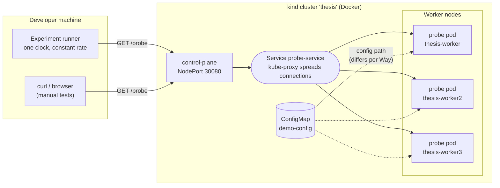
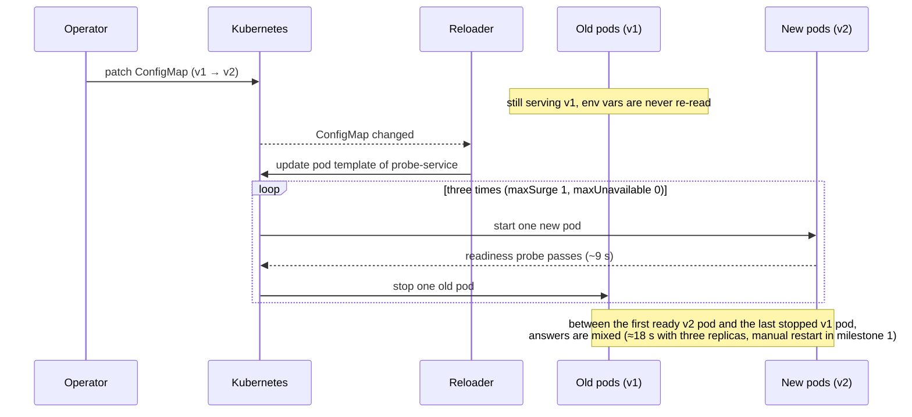
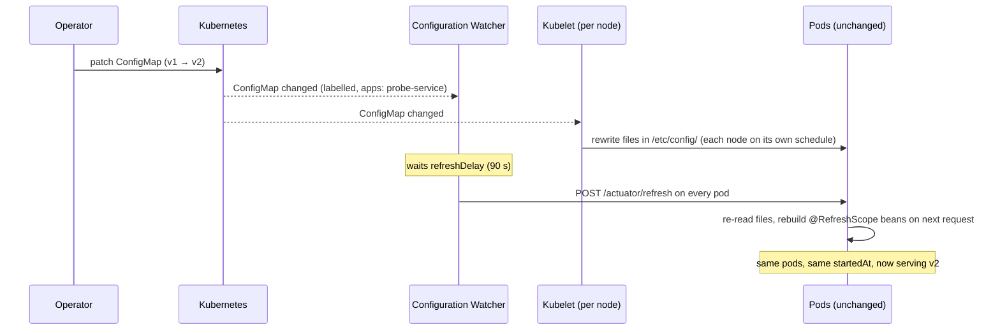

# Architecture

## Context and goals

A configuration change is not atomic across replicas. While it propagates, replicas
of one service answer with different configuration versions. Nothing fails and
monitoring stays green, so the problem is invisible by default.

The setup has three goals:

1. Make the window observable: every response must say which replica answered
   and which configuration it used.
2. Measure it reliably: timestamps come from one clock, outside the cluster,
   at a constant request rate.
3. Compare the configuration approaches fairly: the same service, cluster and
   measurement are used for every approach. Only the configuration path changes.

## Overview

### Components

| Component | Location | Role |
|---|---|---|
| probe-service | `services/probe-service/` | The object under study. Reports its config version, pod name and start time on every request. See [Probe service API](probe-api.md). |
| kind cluster | `deploy/kind/kind-cluster.yaml` | One control plane and three workers, so per-node effects can appear. |
| Namespace `thesis` | `deploy/namespace.yaml` | Holds every experiment object. Deleting it resets an experiment. |
| Way A manifests | `deploy/way-a-envvar/` | ConfigMap, Deployment with three replicas, NodePort Service. |
| Way B manifests | `deploy/way-b-volume/` | Same service, configuration mounted as files, ConfigMap labelled for the Watcher. |
| Platform | `deploy/platform/` | Activation triggers that run across experiments: Reloader (Way A) and the Configuration Watcher (Way B). Installed once, never reset. Move in progress. |
| Way C | `deploy/way-c-configserver/` | Planned: Config Server, RabbitMQ, Bus refresh. |
| Experiment runner | `tools/experiment-runner/` | Measurement instrument: constant request rate, new connection per request, coverage check, raw data in `results/raw/`. See [Experiment runner](runner.md). |

## The three configuration paths

The service is identical in every approach. What changes is how configuration
reaches the running process and what makes it take effect.

| | Way A | Way B | Way C |
|---|---|---|---|
| Source | ConfigMap | ConfigMap | Git repository via Config Server |
| Enters the pod as | Environment variables | Files in `/etc/config/` | HTTP fetch from the Config Server |
| Read by Spring | Once, at process start | On every refresh (`configtree:`) | On every refresh (`configserver:`) |
| Activation | Rolling restart, started by Reloader | Configuration Watcher calls `/actuator/refresh` after `refreshDelay` | `POST /actuator/busrefresh` over RabbitMQ |
| Pod restarted? | Yes (new `startedAt`) | No | No |
| Extra components | Reloader | Configuration Watcher | Config Server, RabbitMQ |
| Status | Working | Working | Planned |

### Way A in detail

### Way B in detail

If the refresh arrives before a node's kubelet has rewritten the files, that pod
re-reads the old files and stays on the old version until the next change. The
lowest safe `refreshDelay` is therefore the slowest kubelet delay in the cluster.

## Design decisions

Each decision is recorded in full, with rejected alternatives, in
[docs/DECISIONS.md](../docs/DECISIONS.md). In short:

| Decision | Why |
|---|---|
| Measure client-side, from outside the cluster | One clock for every timestamp; no competition for CPU with the pods |
| `PodIdentity` is not `@RefreshScope` | `startedAt` must survive a refresh to tell a restart from a refresh |
| No `subPath` mounts in Way B | The kubelet never updates a `subPath` mount |
| kind with three workers | Per-node effects need several nodes; free and reproducible |
| Topology spread with `nodeTaintsPolicy: Honor` and `matchLabelKeys` | One replica per node, without stalled rollouts or skewed placement |
| NodePort, not `port-forward` | `port-forward` reaches only one pod and would hide the window |

## Data flow of one observation

1. A client sends `GET /probe` to `localhost:30080`.
2. kind forwards the port into the control-plane node.
3. kube-proxy chooses one ready pod for the connection.
4. The pod answers with its current `configVersion`, `pod`, `startedAt`, `servedAt`.
5. The client records its own receive time. Comparing versions across responses
   over time gives the inconsistency window.

kube-proxy balances connections rather than individual requests. A client that keeps one
connection open keeps reaching the same pod. The experiment runner must open a new
connection for each request.

## Known limitations

| Limitation | Effect | Handling |
|---|---|---|
| All kind nodes share one clock and kernel | Real clock offset between nodes is not reproduced | Primary metric is measured on the runner's clock; stated as a threat to validity |
| Nodes share the machine's CPUs | Heavy background load can distort results | No other heavy work during measurement campaigns |
| A replica is only observed when a request reaches it | Measured window is a lower bound | Sampling bound derived and reported |
