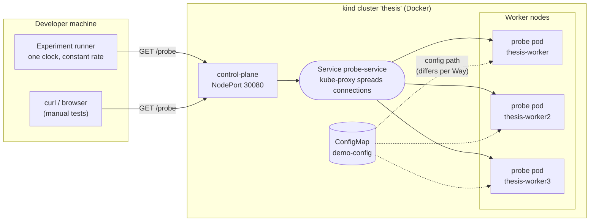
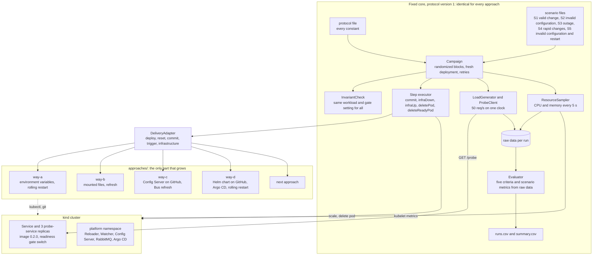
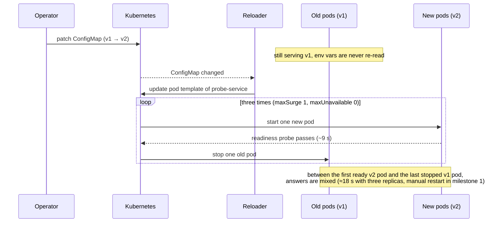
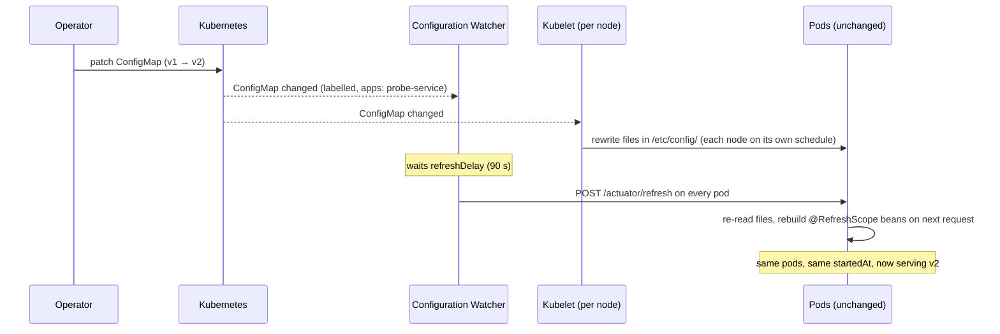
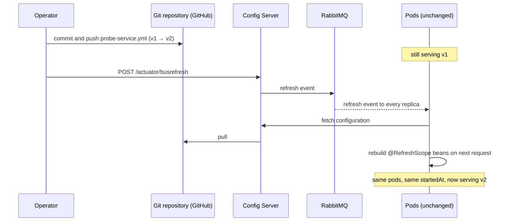
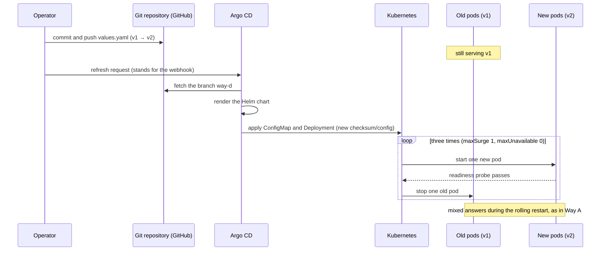

# Architecture

## Context and goals

A configuration change is not atomic across replicas. While it propagates, replicas
of one service answer with different configuration versions. Nothing fails and
monitoring stays green, so the problem is invisible by default.

The setup has three goals:

1. Make the window observable: every response must say which replica answered
   and which configuration it used.
2. Measure it reliably: timestamps come from one clock, outside the cluster,
   at a constant request rate.
3. Compare the configuration approaches fairly: the same service, cluster and
   measurement are used for every approach. Only the configuration path changes.

Since protocol version 1 (2026-11-15) the third goal is enforced by the structure
of the code. Everything that measures is a fixed core. An approach is a folder
with manifests and one descriptor file, and the core reaches it only through an
adapter. The specification is [docs/experiment-plan.md](../docs/experiment-plan.md).

## Overview



### Components

| Component | Location | Role |
|---|---|---|
| probe-service | `services/probe-service/` | The object under study. Reports its config version, pod name and start time on every request. See [Probe service API](probe-api.md). |
| kind cluster | `deploy/kind/kind-cluster.yaml` | One control plane and three workers, so per-node effects can appear. |
| Namespace `thesis` | `deploy/namespace.yaml` | Holds every experiment object. Deleting it resets an experiment. |
| Way A manifests | `deploy/way-a-envvar/` | ConfigMap, Deployment with three replicas, NodePort Service. |
| Way B manifests | `deploy/way-b-volume/` | Same service, configuration mounted as files, ConfigMap labelled for the Watcher. |
| Way C manifests | `deploy/way-c-configserver/` | Same service, configuration fetched from the Config Server, Bus enabled. |
| Way D manifests | `deploy/way-d-gitops/` | The Argo CD Application and its project. The folder `chart/` is a copy of the Helm chart of the same service. Argo CD reads the chart from the branch `way-d` of the configuration repository. |
| Platform | `deploy/platform/`, `deploy/reloader/` | Namespace `platform` with the delivery components of all approaches: Reloader (Way A), the Configuration Watcher (Way B), Config Server and RabbitMQ (Way C), Argo CD (Way D, `deploy/platform/argocd/`). Installed once. All of them run during every run. |
| Config Server | `services/config-server/` | Spring Cloud Config Server that reads a Git repository on GitHub. |
| Monitoring | `deploy/monitoring/` | Namespace `monitoring` with Loki, Alloy and Grafana on the control-plane node. Keeps the pod logs and shows loaded results. It is not part of what is measured. See the [monitoring runbook](runbook-monitoring.md). |
| Experiment runner | `tools/experiment-runner/` | Measurement instrument and fixed core: campaigns, load, resource sampling, evaluation. See [Experiment runner](runner.md). |
| Protocol, scenarios, approaches, campaigns | `protocol/`, `scenarios/`, `approaches/`, `campaigns/` | The input files of a campaign. See [Input files](runner.md#input-files). |

## The fixed core and the adapter boundary

The diagram is the one of the plan.



The core holds no approach name, no ConfigMap name and no key. It knows the
workload only through the protocol file (namespace `thesis`, Deployment
`probe-service`) and an approach only through the interface `DeliveryAdapter`.
One class implements it, `CommandAdapter`, which runs the commands of a descriptor
file.

| Operation | Meaning | Timing counted |
|---|---|---|
| `deploy` | `kubectl apply -f` of the manifests. Result: 3 replicas serving v1 | No, before the run |
| `reset` | Put the configuration source back to v1 | No, before the run |
| `commit(payload)` | Make a `configVersion` and a `timeoutMs` the source of truth in one atomic change | Start is `t_cs`, end is `T0` |
| `trigger` | Optional. Whatever a webhook or operator would do after the commit | Yes, part of propagation |
| `sourceCheck` | Optional. A command whose duration shows how reachable the source is | No, stored in the meta file |
| `infrastructure` | Namespace and Deployment of each delivery component | Used for overhead and for the outage scenario |
| `declared` | Extra components, operator actions per change, RBAC scope, coupling | Reported as declared (O5) |

How the four approaches fill the contract:

| | Way A | Way B | Way C | Way D |
|---|---|---|---|---|
| Descriptor | `approaches/way-a/approach.json` | `approaches/way-b/approach.json` | `approaches/way-c/approach.json` | `approaches/way-d/approach.json` |
| `manifests` | `deploy/way-a-envvar` | `deploy/way-b-volume` | `deploy/way-c-configserver` | `deploy/way-d-gitops`, the Argo CD Application |
| `reset` | The `kubectl patch` of `commit` with v1 | The `kubectl patch` of `commit` with v1 | The commit script with v1 | `tools/way-d-reset.sh`: commit of v1, Application created again, wait for the sync |
| `commit` | `kubectl patch` of `configVersion` and `timeoutMs` in `demo-config` | `kubectl patch` of `demo.configVersion` and `demo.timeoutMs` in `demo-config` | `tools/way-c-commit.sh`: one Git commit, pushed to GitHub | `tools/way-d-commit.sh`: one Git commit to `values.yaml`, pushed to the branch `way-d` |
| `trigger` | none | none | `POST /actuator/busrefresh` inside the Config Server pod | `kubectl annotate` of the Application with a refresh request |
| `sourceCheck` | none | none | `git ls-remote` | `git ls-remote` |
| `infrastructure` | `platform/reloader-reloader` | `platform/config-watcher` | `platform/config-server`, `platform/rabbitmq` | `platform/argocd-application-controller`, `platform/argocd-repo-server`, `platform/argocd-redis` |

The descriptor has no field for rate, replicas, durations, repetitions or validity
rules, so an approach has no place to change the measurement.

Way D is the one approach where `deploy` does not create the pods. Argo CD creates
them from Git during `reset`, and `deploy` applies the Application file, which is
then unchanged. The fixed fields are checked on the live Deployment as for every
approach.

### What the core checks before every run

`InvariantCheck` reads the live Deployment, Service and pods and stops the
campaign if a fixed field differs from the protocol file.

| Fixed for all, checked | Free per approach |
|---|---|
| 3 replicas, 3 running pods, one per node | Environment variables other than `CONFIG_GATE_ENABLED`, volumes and mounts |
| Image `probe-service:0.2.0`, and the same image id in every run of a campaign | Labels and annotations |
| CPU and memory requests and limits | `preStop` and rollout strategy |
| Readiness probe path, port and period | Configuration source objects (ConfigMap, Git repository) |
| One topology spread constraint with the key, skew and policy of the protocol | Delivery components in `platform` |
| Service type, port, target port, node port and selector | Parameters of those components, for example `refreshDelay` |
| `CONFIG_GATE_ENABLED` equal to the gate of the scenario | |

The campaign also checks that every infrastructure Deployment of every approach
has at least one replica and all of them ready, so the background load is the same
in every run.

### Collection and evaluation are separate

A run produces a `RunRecord` with observations, resource samples, step times and
pod lists. `ResultWriter` saves it as four files. `Evaluator` computes every
metric from a `RunRecord` only. Because of that a campaign folder can be evaluated
again later with `--evaluate`, and the verdict of a run never depends on anything
that is not on disk.

## Timeline of one run

```
        not measured                 measured on the runner clock
 ___________________________   _____________________________________________________
|        |         |        | |          |            |                             |
| reset  | deploy  | settle | | warm-up  | baseline B | observation H               |
|        |         | 100 s  | | 30 s     | 60 s       | 150 s                       |
|________|_________|________| |__________|____________|_____________________________|
                              0          30 s         t_cs  T0                      t_cs + 150 s
                                                      |     |
                                              commit starts  commit acknowledged, trigger fires

 load at 50 req/s:            |======================================================|
 resource samples every 5 s:  |======================================================|
```

This is S1. Every run starts from a deleted Deployment and a source reset to v1,
so no approach carries state from the run before. The source is reset before the
workload is deployed, so no trigger fires on a fresh Deployment.

| Symbol | Definition |
|---|---|
| `t_cs` | Start of the first `commit` command |
| `T0` | End of that command with exit code 0. The source of truth holds the new version |
| `B` | The 60 s before the start of the first step |
| `H` | The 150 s after the start of the first step |

The first step is due at 90 s. `B` and `H` are placed at the time it really
started, a few milliseconds later. In S1 and S2 the first step is the commit, so
`B` ends at `t_cs`. In S3 the first step is `infraDown` and the commit follows
30 s later. A request belongs to an interval by its intended send time.

Everything after `T0` is delivery time, whether a controller reacts or a trigger
is called. Way C's `busrefresh` call therefore counts, as the reaction times of
Reloader and the Watcher do.

## The five scenarios

A scenario is a file in `scenarios/` with timed steps. The steps and offsets are
the same for every approach, and the core executes them.

| Scenario | Question | Gate | Steps, offset from the end of the baseline | Load ends | Metrics |
|---|---|---|---|---|---|
| S1 valid change | The five criteria | off | 0 s commit v2 with `timeoutMs` 1000 | 240 s | P1 to O5 |
| S2 invalid configuration | Does a bad configuration reach traffic, what does it cost, how fast does the fix arrive | on | 0 s commit v2 with `timeoutMs` `abc`. 120 s commit v3 with `timeoutMs` 1000 | 360 s | E1 to E4, R1 |
| S3 infrastructure outage | What happens to a change and to a restarted pod while the delivery components are down | off | 0 s `infraDown`. 30 s commit v2. 60 s `deletePod`. 120 s `infraUp` | 360 s | U1 to U5 |
| S4 rapid successive changes | Do all replicas end on the last version when a second change follows 10 s after the first, and which versions are served in between | off | 0 s commit v2. 10 s commit v3, both with `timeoutMs` 1000 | 250 s | Q1 to Q7 |
| S5 invalid configuration and pod restart | What happens to a pod that starts while the invalid configuration is still in the source | on | 0 s commit v2 with `timeoutMs` `abc`. 60 s `deleteReadyPod`. 120 s commit v3 with `timeoutMs` 1000 | 360 s | E1 to E4, R1 |

The load runs for 150 s after the start of the last step, which gives 240 s in S1,
360 s in S2, S3 and S5, and 250 s in S4.

Every payload has its own version. The version in an answer therefore tells which
payload the answering pod runs, and the runner sees an invalid configuration from
outside without a new endpoint.

S2 runs with the [readiness gate](probe-api.md#the-readiness-gate) on. Without it
an invalid `timeoutMs` changes nothing in the service and S2 would repeat S1. The
120 s before the fix stand for the time an operator needs to notice. They are
fixed by the scenario and are not a result.

In S3 `infraDown` scales the infrastructure Deployments of the approach under test
to 0 and `infraUp` scales them back. The core restores them at the end of every
run, also after an error, and the next run starts only when they are ready.

S5 is S2 with one step more. `deleteReadyPod` deletes the first pod by name
among the ready pods, where `deletePod` takes the first by name whether it is
ready or not. During a stopped rollout of Way A or Way D one pod is unready,
and S5 must delete a pod that serves. The value to compare with S2 is E4. The
reasons are in the
[decision entry](../docs/DECISIONS.md#2026-11-21-s5-deletes-a-ready-pod-while-the-invalid-configuration-waits-at-the-source).

S4 was added on 2026-11-21, after the plan was frozen. The steps of a scenario
run one after the other, so a commit that takes longer than 10 s pushes the
second commit back. Q7 records the real gap. The reasons for the scenario, the
incident reports behind it and the definitions of Q1 to Q7 are in the
[decision entry](../docs/DECISIONS.md#2026-11-21-s4-commits-two-valid-changes-10-seconds-apart).

The five criteria and the metric definitions of S1 to S3 are in the
[plan](../docs/experiment-plan.md#the-five-criteria). A worked example for every
metric is in the [code walkthrough](code-walkthrough.md#the-metrics). What the
approaches did in the smoke runs is in
[journal entry 06](journal/06-experiment-protocol.md).

## The four configuration paths

The service is identical in every approach. What changes is how configuration
reaches the running process and what makes it take effect.

| | Way A | Way B | Way C | Way D |
|---|---|---|---|---|
| Source | ConfigMap | ConfigMap | Git repository via Config Server | Helm chart in a Git repository via Argo CD |
| Enters the pod as | Environment variables | Files in `/etc/config/` | HTTP fetch from the Config Server | Environment variables, from the ConfigMap that Argo CD renders |
| Read by Spring | Once, at process start | On every refresh (`configtree:`) | On every refresh (`configserver:`) | Once, at process start |
| Activation | Rolling restart, started by Reloader | Configuration Watcher calls `/actuator/refresh` after `refreshDelay` | `POST /actuator/busrefresh` on the Config Server, sent to every replica over RabbitMQ | Rolling restart, started by the sync: the annotation `checksum/config` of the pod template changes |
| Pod restarted? | Yes (new `startedAt`) | No | No | Yes |
| Extra components | Reloader | Configuration Watcher | Config Server, RabbitMQ | Argo CD application controller, repo server, Redis |
| Status | Working | Working | Working | Working by hand. Not run by the runner yet |

### Way A in detail



### Way B in detail



If the refresh arrives before a node's kubelet has rewritten the files, that pod
re-reads the old files and stays on the old version until the next change. The
lowest safe `refreshDelay` is therefore the slowest kubelet delay in the cluster.

### Way C in detail



The operator has two actions per change: the push and the refresh call. In the
experiment the push is the `commit` and the refresh call is the `trigger`. The
Config Server reads `https://github.com/AimenFH/config-delivery-config.git`, so
every Way C number contains a round trip to GitHub. The pods need the Config
Server when they start (`SPRING_CONFIG_IMPORT` is
`configserver:http://config-server.platform.svc:8888`).

### Way D in detail



Nobody applies the Deployment in Way D. The Application
`deploy/way-d-gitops/application.yaml` tells Argo CD to make the namespace
`thesis` look like the folder `probe-service` on the branch `way-d`. The chart
puts the hash of the rendered ConfigMap on the pod template, so a new value in
`values.yaml` changes the pod template and Kubernetes restarts the pods one by
one.

The Application syncs automatically and without self-heal. Argo CD acts once per
new commit and leaves later changes in the cluster alone. That is what lets the
runner set `CONFIG_GATE_ENABLED` and lets the other approaches use the same
Deployment name. In one change by hand on 2026-11-21 the first answer with v2
came 21 s after the refresh request and the last answer with v1 after 49 s. Steps
by hand are in the [Way D runbook](runbook-way-d.md).

## Design decisions

Each decision is recorded in full, with rejected alternatives, in
[docs/DECISIONS.md](../docs/DECISIONS.md). In short:

| Decision | Why |
|---|---|
| Measure client-side, from outside the cluster | One clock for every timestamp; no competition for CPU with the pods |
| `PodIdentity` is not `@RefreshScope` | `startedAt` must survive a refresh to tell a restart from a refresh |
| No `subPath` mounts in Way B | The kubelet never updates a `subPath` mount |
| kind with three workers | Per-node effects need several nodes; free and reproducible |
| Topology spread with `nodeTaintsPolicy: Honor` and `matchLabelKeys` | One replica per node, without stalled rollouts or skewed placement |
| NodePort, not `port-forward` | `port-forward` reaches only one pod and would hide the window |
| Fresh deployment at v1 before every run | Every approach starts every run from the same state |
| `T0` is the end of the commit, the trigger counts as delivery | The one moment every approach has; no approach gets its trigger for free |
| Fixed phase lengths in one protocol file | Failed requests and latency are counted over windows of the same length |
| Randomized blocks | Drift of the machine over a night is not confounded with the approach |
| A run is INVALID only when the instrument failed | Bad behaviour of an approach is a result and stays in the data |
| Scenarios as files executed by the core | An approach cannot shape its own test |
| Readiness gate in probe-service behind `CONFIG_GATE_ENABLED` | An invalid configuration gets an effect that is the same for every approach |
| Way D with Argo CD and a Helm chart | The fourth approach is built the way a team with GitOps would build it |
| Argo CD without self-heal, on its own branch | It must not undo the gate setting of the runner or the Deployment of another approach |
| Way D's trigger is a refresh request | It stands for the webhook that GitHub cannot send to a local cluster |

## Data flow of one observation

1. A client sends `GET /probe` to `localhost:30080`.
2. kind forwards the port into the control-plane node.
3. kube-proxy chooses one ready pod for the connection.
4. The pod answers with its current `configVersion`, `pod`, `startedAt`, `servedAt`.
5. The client records its own receive time. Comparing versions across responses
   over time gives the inconsistency window.

kube-proxy balances connections rather than individual requests. A client that keeps one
connection open keeps reaching the same pod. The experiment runner must open a new
connection for each request.

## Known limitations

| Limitation | Effect | Handling |
|---|---|---|
| All kind nodes share one clock and kernel | Real clock offset between nodes is not reproduced | Primary metric is measured on the runner's clock; stated as a threat to validity |
| Nodes share the machine's CPUs | Heavy background load can distort results | No other heavy work during measurement campaigns |
| A replica is only observed when a request reaches it | Measured window is a lower bound | Sampling bound derived and reported |
| Way C and Way D read from GitHub over the internet | Their commit and propagation times include network latency | Kept for realism. P3 and the `sourceCheck` duration are recorded per run |
| Argo CD runs with self-heal off | The correction of drift, a main reason for GitOps, is not part of the experiment | Stated |
| Argo CD runs in the background of every run since 2026-11-21 | Numbers from earlier campaigns were measured without it | A smoke campaign before the full campaigns, see [journal entry 10](journal/10-way-d-argo-cd-and-helm.md#open-points) |
| Each approach is measured in one configuration | Way B's 90 s is its `refreshDelay`, Way A's window depends on readiness time and surge settings | Results describe configurations, settings documented |
| S3 takes all delivery components of an approach down at once | For Way C the effects of Config Server and RabbitMQ are not separated, for Way D those of the three Argo CD components | Stated |

The full list is in the [plan](../docs/experiment-plan.md#scientific-limitations).
