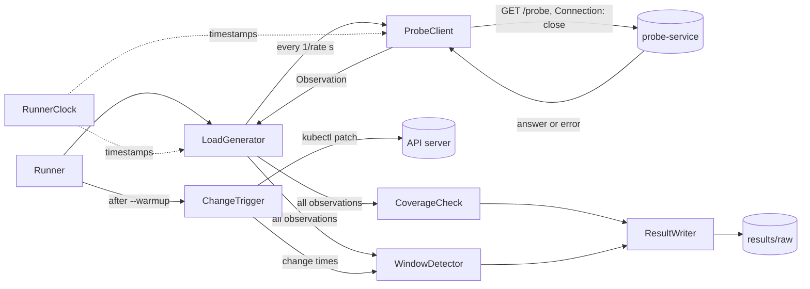

# Experiment runner

The experiment runner is the measuring instrument of the thesis. It sends requests
to the probe service at a constant rate, timestamps every answer on one clock,
checks that every replica was observed often enough, and saves every observation
to a file. The probe service is the object under study; the runner only observes it.

Status: all four stages are done. The runner can apply a configuration change
after a warm-up and computes the inconsistency window from its own observations.

## Quick start

You need Java 21 or newer, Maven, and a running cluster with Way A or Way B on
port 30080 (see the [Way A runbook](runbook-way-a.md)).

Build once, and again after every code change. This also runs the unit tests of the
window detector:

```bash
cd tools/experiment-runner && mvn -q package && cd ../..
```

Run from the repository root, so the data lands in `results/raw/`. This run probes
for 5 s, then changes the version on Way B and keeps probing for 150 s:

```bash
java -jar tools/experiment-runner/target/experiment-runner.jar --warmup 5 --duration 150 --label way-b -- kubectl -n thesis patch configmap demo-config --type merge -p '{"data":{"demo.configVersion":"v4"}}'
```

The key depends on the Way. Way B reads `demo.configVersion`, Way A reads
`configVersion`. Patching the wrong key adds a new key that nothing reads, and the
run ends with "new version never observed". The new value must also differ from the
current one:

```bash
kubectl -n thesis get configmap demo-config -o jsonpath='{.data}'
```

Expected output of the run:

```
Probing http://localhost:30080/probe at 50 req/s: 5 s warm-up, then 150 s
Requests: 7750 scheduled, 7750 recorded, 7750 ok, 0 failed
Per config version:
  v3                                        4765
  v4                                        2985
Latency ms: p50 1.3  p90 2.0  p99 6.0  max 104.6
Change: exit 0, started 5215.7 ms, finished 5271.5 ms
  configmap/demo-config patched
Coverage per pod:
  probe-service-f664c8f55-5pswb             2591  (33.4 %)  longest unobserved    341 ms
  probe-service-f664c8f55-cqg4t             2573  (33.2 %)  longest unobserved    405 ms
  probe-service-f664c8f55-fgjvt             2586  (33.4 %)  longest unobserved    400 ms
Window: v3 -> v4
  first new       95527.4 ms  (propagation 90255.9 ms after the change)
  last old        95503.0 ms  (convergence 90255.9 ms after the change)
  window              0.0 ms  (at most 167.4 ms)
  failed requests after the change: 0
Run VALID
Saved /…/config-delivery-thesis/results/raw/20261103-222435_way-b.ndjson
```

A run without `--` and a command is a baseline run, with no change and no window
block.

## Arguments

| Argument | Default | Meaning |
|---|---|---|
| `--url` | `http://localhost:30080/probe` | Endpoint to observe |
| `--rate` | `50` | Requests started per second, on a fixed schedule |
| `--warmup` | `5` | Seconds of load before the change |
| `--duration` | `10` | Seconds of load after the warm-up. Must cover the expected propagation time |
| `--replicas` | `3` | Number of replicas that must be observed |
| `--max-gap-ms` | `1000` | Longest allowed time a pod may go unobserved |
| `--label` | `test` | Free text that becomes part of the run id, for example `way-b` |
| `--out` | `results/raw` | Folder for the output files, relative to where you start the runner |
| `-- <command>` | none | Everything after a bare `--` is the change command, run once after the warm-up. Without it the run has no change |

## Exit codes

| Code | Meaning |
|---|---|
| `0` | The run is valid |
| `2` | The run is invalid. Its files are still written, with `"valid": false` and the reasons |
| other | The runner itself failed, for example a wrong argument |

## Output files

Every run writes two files with the same run id: the local date and time of the
start, followed by the label.

```
results/raw/
├── 20261025-005815_way-b.ndjson      one line per request
└── 20261025-005815_way-b.meta.json   settings and verdict of the run
```

`results/raw/` is listed in `.gitignore` and is not committed. See
[results/README.md](../results/README.md).

### `<run id>.ndjson`

One JSON object per line, one line per request, ordered by `seq`:

```json
{"seq":0,"scheduledAt":193.188917,"sentAt":193.191,"receivedAt":278.25675,"status":200,"pod":"probe-service-f664c8f55-5pswb","configVersion":"v2","startedAt":1792269702999,"error":null}
```

| Field | Unit | Meaning |
|---|---|---|
| `seq` | | Request number, starting at 0. A missing number is a lost request |
| `scheduledAt` | ms since run start | When the request was due according to the fixed schedule |
| `sentAt` | ms since run start | When it was handed to the HTTP client |
| `receivedAt` | ms since run start | When the answer or the error arrived. The window is computed from this field |
| `status` | | HTTP status, or `0` when there was no answer |
| `pod` | | Replica that answered, from the response body |
| `configVersion` | | Configuration version that replica used |
| `startedAt` | epoch ms, pod clock | When that pod's process started. Changes on restart, stays on refresh |
| `error` | | `null`, or the failure with its message, for example `HttpTimeoutException: request timed out`, `ConnectException: Connection refused` or `BadBody` |

All `…At` fields except `startedAt` come from the runner's clock. Add
`runStartedAtEpochMillis` from the meta file to turn them into absolute times.

### `<run id>.meta.json`

Settings, verdict, the change and the window of the run. Shortened:

```json
{
  "runId" : "20261103-222435_way-b",
  "runStartedAt" : "2026-11-03T21:24:35.595Z",
  "runStartedAtEpochMillis" : 1793741075595,
  "ratePerSecond" : 50,
  "durationSeconds" : 150,
  "warmupSeconds" : 5,
  "valid" : true,
  "problems" : [ ],
  "change" : {
    "command" : "kubectl -n thesis patch configmap demo-config --type merge -p {\"data\":{\"demo.configVersion\":\"v4\"}}",
    "startedAt" : 5215.715667,
    "finishedAt" : 5271.451334,
    "exitCode" : 0,
    "output" : "configmap/demo-config patched"
  },
  "window" : {
    "oldVersion" : "v3",
    "newVersion" : "v4",
    "firstNewAt" : 95527.361834,
    "lastOldAt" : 95503.045542,
    "windowMillis" : 0.0,
    "windowMaxMillis" : 167.358958,
    "propagationMillis" : 90255.9105,
    "convergenceMillis" : 90255.9105,
    "failedAfterChange" : 0,
    "problems" : [ ]
  }
}
```

`change` and `window` are `null` in a baseline run. The window fields are `null`
when the new version was never observed.

`runStartedAt` is in UTC, while the run id uses the local time of the machine. In
the example, 00:58 local time is 22:58 UTC.

## The coverage check

kube-proxy chooses a pod at random for each new connection, so a pod can go
unobserved for a while even when the overall shares look even. A version switch on
that pod would then be noticed late. The runner therefore checks, for each pod, the
longest time between two of its observations.

A run is invalid when:

- a pod went unobserved for longer than `--max-gap-ms`, or
- fewer pods than `--replicas` were observed at all.

Example of an invalid run, started with `--replicas 4` against three pods:

```
Run INVALID
  - only 3 of 4 replicas were observed
```

The gap is measured per pod and only between that pod's own observations, so pods
that appear or disappear during a Way A rollout do not make a run invalid on their
own. At 50 req/s and three replicas the longest gaps were between 219 and 460 ms in
the test runs. See [DECISIONS](../docs/DECISIONS.md) for the measurements behind the
default rate.

## The window

The detector works on the observations after the run, with times in ms on the
runner's clock.

| Field | Meaning |
|---|---|
| `windowMillis` | Last old answer minus first new answer, at least 0. How long both versions were served |
| `windowMaxMillis` | Upper bound: the window plus the unobserved time before the first new answer and after the last old answer, each on its own pod |
| `propagationMillis` | First new answer minus the end of the change command |
| `convergenceMillis` | The later of last old and first new answer, minus the end of the change command |
| `failedAfterChange` | Failed requests from the change to the end of the run |

The measured window is a lower bound. When a pod switches faster than the runner
can observe it, the window is 0 and only `windowMaxMillis` says how much overlap
could have been missed. The definitions and the reasons behind them are in
[DECISIONS](../docs/DECISIONS.md).

A run with a change is also invalid when:

- the warm-up shows more than one version,
- the new version is never observed,
- a pod that is still serving at the end of the run (observed in its last
  `--max-gap-ms`) answers with the old version, or
- a pod answers with the old version on a request sent after it had already
  answered with the new one.

## How it works



| Class | Responsibility |
|---|---|
| `Runner` | Reads the arguments, wires the parts together, prints the summary, sets the exit code |
| `RunnerClock` | Reads the wall clock once at start, then advances with `System.nanoTime()`, so timestamps cannot jump during a run |
| `LoadGenerator` | Starts a request every 1/rate seconds with `scheduleAtFixedRate` and never waits for answers |
| `ProbeClient` | Sends one request with `sendAsync` and turns any outcome, including errors, into an `Observation` |
| `Observation` | One request and its answer |
| `CoverageCheck` | Computes the longest unobserved gap per pod and decides whether the run is valid |
| `ChangeTrigger` | Runs the change command as a child process and records when it started and finished |
| `WindowDetector` | Finds the old and new version, computes window, propagation and convergence, and checks the run for regressions or a missing switch |
| `RunResult` | Settings and verdict of a run, written as the meta file |
| `ResultWriter` | Writes the NDJSON and the meta file |

Three choices make the numbers trustworthy:

- Requests follow a fixed schedule and never wait for earlier answers, and latency
  is measured from the scheduled time. A slow system cannot slow down its own
  measurement (no coordinated omission).
- Every request opens a new connection (`Connection: close` over HTTP/1.1), because
  kube-proxy only chooses a pod when a connection opens. Without it, 300 of 301
  requests in a test reached the same pod.
- There is one clock, in one process, outside the cluster.

The runner is plain Java 21 with Jackson as its only dependency, plus JUnit 5 for
the tests. The shade plugin packs the runner and Jackson into
`target/experiment-runner.jar`.

## Known limitations

| Limitation | Effect |
|---|---|
| The first seconds of a run include the runner's own JVM warm-up | Higher latency at the start (p99 777 ms in a 10 s test, 15 ms in a 30 s test). `--warmup` keeps this away from the change |
| Connect and request timeout are both 2 s | A timed-out request does not show whether the connection was ever accepted |
| The change time includes starting `kubectl` | The change is only known to within `finishedAt - startedAt` of the change block |
| A replica is only observed when a request reaches it | Any measured window is a lower bound, off by at most the longest gap |
| Observations are kept in memory until the end | Fine for runs of minutes; not meant for hours |
