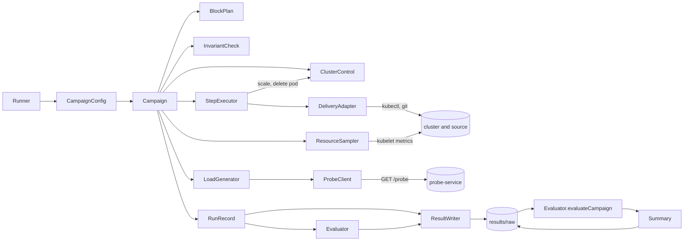

# Experiment runner

The experiment runner is the measuring instrument of the thesis. It sends requests
to the probe service at a constant rate, timestamps every answer on one clock,
applies configuration changes itself, and saves everything it saw. The probe
service is the object under study; the runner only observes it.

Status: the runner runs whole campaigns of protocol version 1. A campaign takes one
scenario, runs every approach in randomized blocks from a fresh deployment, writes
the raw data of every run and computes the metrics from the raw data. The three
smoke campaigns ran on 2026-11-15. The full campaigns have not been run. The
specification is [docs/experiment-plan.md](../docs/experiment-plan.md), the
procedures are in the [experiment runbook](runbook-experiment-1.md), and every
class is explained in the [code walkthrough](code-walkthrough.md).

## Quick start

You need Java 21 or newer, Maven, `kubectl`, and the cluster prepared as described
in the [runbook](runbook-experiment-1.md#before-a-campaign).

Build once, and again after every code change. This also runs the unit tests:

```bash
cd tools/experiment-runner && mvn -q package && cd ../..
```

Run from the repository root, because every path in the campaign, protocol and
descriptor files is relative to it and the data lands in `results/raw/`:

```bash
caffeinate -dims java -jar tools/experiment-runner/target/experiment-runner.jar --campaign campaigns/s1-smoke.json
```

Expected output, here built from the result files of the smoke campaign of
2026-11-15:

```
Campaign 20261115-155726_s1-smoke: 2 valid runs per approach, at most 2 blocks, results in /…/results/raw/20261115-155726_s1-smoke
Block 1 of at most 2: [way-a, way-b, way-c]
  20261115-155727_way-a_b01_a1 VALID
  20261115-160431_way-b_b01_a1 VALID
  20261115-161113_way-c_b01_a1 VALID
Block 2 of at most 2: [way-b, way-a, way-c]
  20261115-161810_way-b_b02_a1 VALID
  20261115-162447_way-a_b02_a1 VALID
  20261115-163122_way-c_b02_a1 VALID
Valid runs: {way-a=2, way-b=2, way-c=2}
Evaluated 6 runs (6 valid) in /…/results/raw/20261115-155726_s1-smoke
Saved /…/results/raw/20261115-155726_s1-smoke/runs.csv
Saved /…/results/raw/20261115-155726_s1-smoke/summary.csv
```

Each run prints its line only when it is over, so nothing appears for about 7
minutes at a time. This campaign started at 15:57 and wrote its last file at 16:38.

## Arguments

The runner has three modes. The first matching argument decides.

| Argument | Meaning |
|---|---|
| `--campaign <file>` | Runs a campaign from a campaign file, then evaluates its folder. All other arguments are ignored |
| `--evaluate <campaign dir>` | Rebuilds `runs.csv` and `summary.csv` of a campaign folder from its raw files. Touches nothing in the cluster |
| none of the two | The old [single-run mode](#single-run-mode) |

A campaign has no argument for rate, durations, replicas or repetitions. These
values come from the protocol file and the campaign file only.

## Exit codes

| Mode | Code | Meaning |
|---|---|---|
| `--campaign` | `0` | Every approach reached its number of valid runs |
| | `2` | The blocks are used up and at least one approach has fewer valid runs than asked |
| | `1` | The campaign stopped early. The line `Campaign stopped: <reason>` says why. What was written stays, and the folder is still evaluated |
| `--evaluate` | `0` | Both CSV files were written |
| single run | `0` | The run is valid |
| | `2` | The run is invalid. Its files are still written |
| any | other | The runner itself failed, for example a campaign file with an unknown field. Java prints the exception |

The cases behind code `1` are listed in the
[runbook](runbook-experiment-1.md#troubleshooting).

## Input files

A campaign reads four kinds of files. Each is checked before anything starts, and
an unknown or missing field stops the runner with the reason.

```
campaigns/s1-smoke.json          which scenario, how many valid runs, block seed
  └─ protocol/protocol-v1.json   every constant, fixed for all approaches
       └─ approaches/<name>/approach.json    one per approach: how to deploy, reset, commit, trigger
  └─ scenarios/s1-valid-change.json          timed steps, the same for every approach
```

### Campaign file

`campaigns/s1-smoke.json`:

```json
{
  "name": "s1-smoke",
  "protocol": "protocol/protocol-v1.json",
  "scenario": "scenarios/s1-valid-change.json",
  "validRuns": 2,
  "maxBlocks": 2,
  "seed": 20261115
}
```

| Field | Meaning |
|---|---|
| `name` | Becomes part of the campaign id |
| `protocol` | Path of the protocol file |
| `scenario` | Path of the scenario file |
| `validRuns` | Valid runs needed per approach. At least 1, at most `maxBlocks` |
| `maxBlocks` | Blocks at most. Not more than `maxBlocks` of the protocol (25) |
| `seed` | Seed of the block order. The same seed gives the same order |

The six campaign files:

| File | Scenario | Valid runs | Blocks at most |
|---|---|---|---|
| `campaigns/s1-smoke.json` | S1 | 2 | 2 |
| `campaigns/s2-smoke.json` | S2 | 1 | 1 |
| `campaigns/s3-smoke.json` | S3 | 1 | 1 |
| `campaigns/s1.json` | S1 | 20 | 25 |
| `campaigns/s2.json` | S2 | 10 | 25 |
| `campaigns/s3.json` | S3 | 10 | 25 |

The files in `campaigns/legacy/` have the format of before 2026-11-15
(`repetitions`, `ways`, `versionKey` and per-Way durations). The runner no longer
accepts them. They are kept to read the old results.

### Protocol file

`protocol/protocol-v1.json` holds every constant of the experiment. No approach
and no campaign can override it.

| Field | Value | Meaning |
|---|---|---|
| `protocolVersion` | 1 | Written into every result file |
| `namespace`, `deployment`, `service` | `thesis`, `probe-service`, `probe-service` | The workload |
| `url` | `http://localhost:30080/probe` | Endpoint the load goes to |
| `replicas` | 3 | Replicas, one per worker node |
| `ratePerSecond` | 50 | Requests per second, open loop |
| `requestTimeoutMillis` | 2000 | Connect and request timeout |
| `initialVersion`, `initialTimeoutMs` | `v1`, `1000` | State every run starts from |
| `targetVersion` | `v2` | Must differ from `initialVersion`. The versions of a run come from the scenario file |
| `unconfiguredVersion` | `v0` | The version probe-service answers without external configuration. Accepted after the baseline, with the flag `UNCONFIGURED` |
| `settleSeconds` | 100 | Wait after the rollout |
| `warmupSeconds` | 30 | Load that is not evaluated |
| `baselineSeconds` | 60 | Length of the baseline `B` |
| `observationSeconds` | 150 | Length of `H`, and the time the load runs on after the last step |
| `resourceSamplingSeconds` | 5 | Period of the resource sampler |
| `coverageLimitMillis` | 1000 | Longest time a pod may go unobserved |
| `maxBlocks` | 25 | Upper limit for the campaign file |
| `retriesPerBlock` | 2 | Repeats of an invalid run inside a block |
| `steadyProbes` | 60 | Requests per steady state snapshot |
| `steadyMaxLatencyMillis` | 200 | Slowest allowed answer in a snapshot |
| `steadySnapshotGapSeconds` | 10 | Time between two snapshots |
| `steadyTimeoutSeconds` | 120 | Limit for the steady check, and the `--timeout` of every rollout wait |
| `triggerTimeoutSeconds` | 15 | Longest time a `trigger` may run. After that the runner stops it and records exit code 124 |
| `scheduleLagLimitMillis` | 100 | Instrument check: a request may start this late |
| `unsentLimitRatio` | 0.01 | Instrument check: share of scheduled requests without an observation |
| `resourceGapLimitSeconds` | 15 | Instrument check: longest gap between resource samples of a node |
| `bootstrapResamples`, `bootstrapSeed` | 10000, 20261115 | Bootstrap interval of the median in `summary.csv` |
| `approaches` | three paths | The approach descriptors, in the order used for the block draw |
| `workload` | object | Fixed fields that `InvariantCheck` compares with the live objects |

The `workload` block: image `probe-service:0.2.0`, container `probe`, requests
250m and 384Mi, limits 500m and 512Mi, readiness probe on
`/actuator/health/readiness` port 8080 every 2 s, one topology spread constraint
on `kubernetes.io/hostname` with max skew 1 and `DoNotSchedule`, and a `NodePort`
Service with port 80, target port 8080, node port 30080 and the selector
`app: probe-service`.

### Scenario file

A scenario is a list of timed steps. `atSeconds` counts from the end of the
baseline, which is 90 s after the load starts.

`scenarios/s2-invalid-config.json`:

```json
{
  "name": "s2-invalid-config",
  "title": "S2 invalid configuration",
  "gate": true,
  "invalidVersions": ["v2"],
  "steps": [
    {"atSeconds": 0, "action": "commit", "payload": {"configVersion": "v2", "timeoutMs": "abc"}},
    {"atSeconds": 120, "action": "commit", "payload": {"configVersion": "v3", "timeoutMs": "1000"}}
  ]
}
```

| Field | Meaning |
|---|---|
| `gate` | Value of `CONFIG_GATE_ENABLED` that the runner sets on the Deployment |
| `invalidVersions` | Versions whose payload is invalid. Each must be the version of a payload |
| `steps[].atSeconds` | Offset of the step. Must not be negative and must not decrease |
| `steps[].action` | `commit`, `infraDown`, `infraUp` or `deletePod` |
| `steps[].payload` | Only for `commit`: `configVersion` and `timeoutMs`. Every payload needs its own version, different from `initialVersion` |

An `infraUp` needs an earlier `infraDown`, and an `infraDown` must be followed by
an `infraUp`.

| Action | Done by | What happens |
|---|---|---|
| `commit` | the approach's commands | Runs `commit` with the payload. If it ends with exit code 0, runs `trigger` when the descriptor has one |
| `infraDown` | the core, `kubectl scale` | Remembers the replica count of every infrastructure Deployment of the approach and scales it to 0 |
| `infraUp` | the core, `kubectl scale` | Scales them back to the remembered count |
| `deletePod` | the core, `kubectl delete pod --wait=false` | Deletes the probe-service pod that comes first by name |

The structure of the file also decides which metrics are reported:

| The scenario has | Metrics | File |
|---|---|---|
| an `infraDown` step | U1 to U5 | `s3-infra-outage.json` |
| otherwise, invalid versions | E1 to E4 and R1 | `s2-invalid-config.json` |
| otherwise | P1 to O5, the five criteria | `s1-valid-change.json` |

### Approach descriptor

`approaches/way-c/approach.json`:

```json
{
  "name": "way-c",
  "title": "Config Server and Bus refresh",
  "manifests": ["deploy/way-c-configserver"],
  "reset": ["bash", "tools/way-c-commit.sh", "{initialVersion}", "{initialTimeoutMs}"],
  "commit": ["bash", "tools/way-c-commit.sh", "{version}", "{timeoutMs}"],
  "trigger": ["kubectl", "-n", "platform", "exec", "deploy/config-server", "--",
              "curl", "-sf", "-X", "POST", "localhost:8888/actuator/busrefresh"],
  "sourceCheck": ["bash", "-c", "git -C \"${CONFIG_REPO:-$HOME/config-repo}\" ls-remote -q origin HEAD"],
  "infrastructure": [
    {"namespace": "platform", "deployment": "config-server"},
    {"namespace": "platform", "deployment": "rabbitmq"}
  ],
  "declared": {
    "extraComponents": ["Config Server", "RabbitMQ"],
    "operatorActionsPerChange": 2,
    "clusterWideRbac": false,
    "serviceCoupling": "config client and bus libraries, startup dependency"
  }
}
```

| Field | Required | Meaning |
|---|---|---|
| `name` | yes | Name in run ids and result files |
| `manifests` | yes | Folders or files, each applied with `kubectl apply -f` |
| `reset` | yes | Command that puts the source back to v1. Must contain `{initialVersion}` and `{initialTimeoutMs}` |
| `commit` | yes | Command that writes a payload in one atomic change. Must contain `{version}` and `{timeoutMs}` |
| `trigger` | no | Command run after a successful commit |
| `sourceCheck` | no | Command timed before every run. Its duration is stored in the meta file and used by no metric |
| `infrastructure` | yes | Namespace and Deployment of every delivery component. Used for O1, O2, O5 and by `infraDown` |
| `declared` | yes | Facts reported as O5 |

Commands are argument lists and are started without a shell. The descriptor has no
field for rate, replicas, durations or validity rules.

Way A and Way B use one `kubectl patch` on two keys of the ConfigMap `demo-config`
as `reset` and `commit` and have no `trigger`. Way C uses
`tools/way-c-commit.sh <version> <timeoutMs>`, which edits both values in
`probe-service.yml` of the configuration repository (`$CONFIG_REPO`, default
`~/config-repo`), makes one commit when the file changed, and pushes. The old
script `tools/way-c-change.sh` no longer exists. Its refresh call is now the
`trigger` of the descriptor.

## What a campaign does

1. Reads the four kinds of files and checks them.
2. Draws the order of all blocks from the seed. Every block holds every approach
   once.
3. Creates `results/raw/<date-time>_<name>/` and writes `campaign.json`,
   `approaches/<name>.json` and `fingerprint.json`.
4. Runs the blocks in order. Before each block it checks whether every approach
   already has its valid runs, and stops if so.
5. Inside a block, each approach is run once. An INVALID run is repeated at once,
   at most `retriesPerBlock` times, then the block moves on.
6. Prints the number of valid runs per approach, evaluates the folder and writes
   `runs.csv` and `summary.csv`.

One run, with the step numbers of the plan:

| # | Step | On failure |
|---|---|---|
| 1 | Delete the Deployment, wait until its pods are gone | Campaign stops |
| 2 | `reset` of the approach, then `sourceCheck` if it has one | Campaign stops on a failed `reset` |
| 3 | `kubectl apply -f` of every manifest, wait for the rollout, set `CONFIG_GATE_ENABLED`, wait for the rollout again | Campaign stops |
| 4 | Settle: wait 100 s | |
| 5 | `InvariantCheck`, all infrastructure Deployments of all approaches up, the same image id as in the first run, steady state | Campaign stops |
| 6 | Read the pod lists and the infrastructure state, start a new clock, the load and the resource sampler | |
| 7 | Execute the steps of the scenario, the first one at 90 s | A failed core step stops the campaign. A failed `commit` makes the run INVALID. A failed `trigger` makes it INVALID unless the commit lies between `infraDown` and `infraUp` |
| 8 | Keep the load until 150 s after the start of the last step | |
| 9 | Stop load and sampler, restore the infrastructure, read pod list and events, evaluate, save the four run files | Campaign stops after saving |

Steady state means two snapshots of 60 requests each, taken 10 s apart, in which
all 3 pods answer, all with `v1`, no request fails, the slowest answer is under
200 ms, and the pod names are the same. The check gives up after 120 s.

## Files of a campaign

```
results/raw/20261115-155726_s1-smoke/
├── campaign.json
├── approaches/way-a.json, way-b.json, way-c.json
├── fingerprint.json
├── 20261115-155727_way-a_b01_a1.ndjson
├── 20261115-155727_way-a_b01_a1.resources.ndjson
├── 20261115-155727_way-a_b01_a1.cluster.json
├── 20261115-155727_way-a_b01_a1.meta.json
├── … four files for every further run
├── runs.csv
└── summary.csv
```

`results/raw/` is listed in `.gitignore`. The small files are copied to
`results/aggregated/`, see [results/README.md](../results/README.md).

A run id is the local start time, the approach, the block and the attempt:
`20261115-172226_way-c_b01_a1`.

### `campaign.json`

`campaignId`, the campaign file as `config`, the complete protocol as `protocol`,
the complete scenario as `scenario`, the approach names as `approaches`, and
`blocks`, the order of every block that was drawn. `--evaluate` reads protocol and
scenario from here, so a folder is evaluated with the constants it was measured
with, even after the files in the repository changed.

### `fingerprint.json`

Written once, before the first run: `gitCommit`, `gitDirty`,
`kubernetesClientVersion`, `kubernetesServerVersion`, `nodeCount`,
`workloadImages`, `infrastructureImages`, `javaVersion`, `os`, `machine`,
`dockerCpus`, `dockerMemoryBytes`. A value that could not be read is `null` and
does not stop the campaign. `workloadImages` shows the pods that were running
before the campaign touched anything.

### `<run id>.ndjson`

One JSON object per line, one line per request, ordered by `seq`:

```json
{"seq":1,"intendedAt":22.530916,"scheduledAt":25.0215,"sentAt":25.02325,"receivedAt":27.316708,"status":200,"pod":"probe-service-f8f7d684f-zmslj","configVersion":"v1","startedAt":1794754694226,"error":null}
```

| Field | Unit | Meaning |
|---|---|---|
| `seq` | | Request number, starting at 0. A missing number is a request that was never recorded |
| `intendedAt` | ms since run start | When the request was due: load start plus `seq` times 20 ms. Decides the interval a request belongs to and is the start of its latency |
| `scheduledAt` | ms since run start | When the ticker really fired. `scheduledAt − intendedAt` is the schedule lag |
| `sentAt` | ms since run start | When it was handed to the HTTP client |
| `receivedAt` | ms since run start | When the answer or the error arrived. Version switches are timed with this field |
| `status` | | HTTP status, or `0` when there was no answer |
| `pod` | | Replica that answered, from the response body |
| `configVersion` | | Configuration version that replica used |
| `startedAt` | epoch ms, pod clock | When that pod's process started |
| `error` | | `null`, or the failure, for example `HttpTimeoutException: request timed out` or `BadBody` |

All `…At` fields except `startedAt` come from the runner's clock. Add
`runStartedAtEpochMillis` from the meta file to turn them into absolute times.

### `<run id>.resources.ndjson`

One line per container per sampling round, for every pod on every node, not only
for the pods of the experiment:

```json
{"at":34.026208,"node":"thesis-control-plane","namespace":"kube-system","pod":"coredns-559f6c778d-kzxhf","container":"coredns","cpuSeconds":101.272425,"workingSetBytes":21753856,"sourceTimestampMillis":1794754821223}
```

`at` is the start of the sampling round on the runner's clock, `cpuSeconds` is the
cumulative counter `container_cpu_usage_seconds_total` of the kubelet,
`workingSetBytes` is `container_memory_working_set_bytes`.

### `<run id>.cluster.json`

`podsBefore` and `podsAfter` (namespace, name, node, image id and start time of
every pod in `thesis` and in the infrastructure namespaces), `infrastructure`
(replica count and requests of the approach's infrastructure Deployments before
the run), and `events` (the Kubernetes events of those namespaces after the run).

### `<run id>.meta.json`

Everything about the run except the three large parts above. Shortened, from the
first Way C run of the S3 smoke campaign:

```json
{
  "runId" : "20261115-172226_way-c_b01_a1",
  "campaign" : "20261115-170505_s3-smoke",
  "approach" : "way-c",
  "scenario" : "s3-infra-outage",
  "protocolVersion" : 1,
  "block" : 1,
  "positionInBlock" : 3,
  "attempt" : 1,
  "runStartedAtEpochMillis" : 1794759913563,
  "gate" : false,
  "loadStartedAt" : 0.528041,
  "runEndAt" : 360002.35608299996,
  "scheduled" : 18001,
  "sourceCheck" : { "startedAt" : -164377.68216599998, "finishedAt" : -163826.904541, "exitCode" : 0 },
  "steps" : [ {
    "index" : 1,
    "atSeconds" : 30,
    "action" : "commit",
    "payload" : { "configVersion" : "v2", "timeoutMs" : "1000" },
    "startedAt" : 120005.059541,
    "finishedAt" : 121727.588333,
    "exitCode" : 0,
    "output" : "pushed v2 with timeoutMs 1000",
    "trigger" : {
      "startedAt" : 121727.739041,
      "finishedAt" : 181770.766291,
      "exitCode" : 1,
      "output" : "error: timed out waiting for the condition"
    },
    "detail" : null
  } ],
  "errors" : [ ],
  "tCs" : 120005.059541,
  "t0" : 121727.588333,
  "verdict" : "INVALID",
  "invalidReasons" : [ "trigger after the commit of v2 failed with exit code 1" ],
  "flags" : [ "LOST_UPDATE" ]
}
```

Times are in ms on the clock of the run. `sourceCheck` happens before that clock
starts, so its times are negative. `tCs` is the start of the first commit and `t0`
its end. `detail` holds what a core step did, for example
`platform/config-server 1 -> 0, platform/rabbitmq 1 -> 0` or the name of the
deleted pod. `errors` lists pod lists or events that could not be read.

`verdict`, `invalidReasons` and `flags` are what the evaluator said when the run
was saved. `--evaluate` ignores them and judges the run again.

### `runs.csv`

One row per run, valid and invalid, sorted by run id. The first nine columns are
the same in every scenario:

`protocolVersion,run_id,approach,block,position,attempt,verdict,reasons,flags`

Then one column per metric column of the scenario:

| Scenario | Columns |
|---|---|
| S1 | `P1`, `P2`, `P3`, `C1`, `C1_max`, `C2`, `C3`, `A1`, `A2`, `A3`, `F1`, `F2_p50_B`, `F2_p95_B`, `F2_p99_B`, `F2_max_B`, `F2_p50_H`, `F2_p95_H`, `F2_p99_H`, `F2_max_H`, `F2_p99_ratio`, `F3`, `O1`, `O2`, `O3_cpu`, `O3_memory`, `O4`, `O5_extraComponents`, `O5_extraComponents_text`, `O5_operatorActions`, `O5_clusterWideRbac`, `O5_serviceCoupling`, `O5_requestedCpu`, `O5_requestedMemory` |
| S2 | `E1`, `E2`, `E3_ratio`, `E3_outage`, `E4`, `R1` |
| S3 | `U1`, `U2`, `U2_text`, `U3`, `U4`, `U5` |

A censored value is written with a leading `>`, for example `>149943.90895799999`.
An empty cell means the metric could not be computed. `U2_text` is the version of
the first answer of the replacement pod. The definitions and a worked example for
every metric are in the [code walkthrough](code-walkthrough.md#the-metrics).

### `summary.csv`

`protocolVersion,kind,approach,other,metric,n,n_other,censored,min,q1,median,q3,max,ci_low,ci_high,cliffs_delta`

| `kind` | Rows | Content |
|---|---|---|
| `count` | per approach | `runs`, `valid`, `invalid`, and each of the six flags. Flags are counted over valid runs only |
| `metric` | per approach and metric column | n, min, quartiles, median, max and the 95 % bootstrap interval of the median, over valid runs |
| `difference` | per pair of approaches and primary metric | Difference of medians with its bootstrap interval, and Cliff's delta |
| `sensitivity` | per approach, for A1 and F1 | The same statistics over all runs with a successful commit, valid or not |

A censored value counts as larger than every number. A median or bound that lands
on one is written as `censored`. Columns that hold only text
(`O5_serviceCoupling`, `O5_requestedCpu`, `O5_requestedMemory`) get a row with
`n` 0.

## Verdict and flags

A run is INVALID only when the instrument failed. Bad behaviour of an approach is
a flag on a VALID run.

| Instrument check | Reason text starts with |
|---|---|
| A pod unobserved for more than 1 000 ms in `B`, or fewer than 3 pods in `B` | `baseline: pod … was unobserved`, `baseline: only … replicas` |
| A failed request in `B` | `baseline: … failed requests` |
| More than one version in `B` | `baseline: more than one version` |
| `commit` with an exit code other than 0, a commit that did not run, or a `trigger` with an exit code other than 0 while the delivery components are up | `commit of … failed`, `commit … of the scenario did not run`, `trigger after the commit of … failed` |
| A request that started more than 100 ms late | `schedule lag over 100 ms` |
| More than 1 % of the scheduled requests without an observation | `… scheduled requests have no observation` |
| An answer with a version that no payload declares. The `unconfiguredVersion` is accepted after `B` | `versions that no payload of the scenario declares` |
| No resource samples, a node without samples, or a gap over 15 s | `no resource samples`, `resource sampling: …` |

The last four are checked from the start of `B` to the end of the run. The warm-up
is not checked.

| Flag | Set when |
|---|---|
| `NOT_CONVERGED` | P1 is reported and v1 is still served at the end of `H`, or v2 never appeared |
| `REGRESSION` | A pod answered an earlier version after a later one (C3 above 0) |
| `FAILED_REQUESTS` | A request failed in `H` (S1) or anywhere after the baseline (S2, S3) |
| `LOW_RESOLUTION` | A pod went unobserved for more than 1 000 ms after the baseline |
| `NOT_RECOVERED` | R1 is censored (S2) |
| `LOST_UPDATE` | U4 is censored (S3) |
| `UNCONFIGURED` | A pod answered the `unconfiguredVersion` after the baseline |
| `TRIGGER_FAILED` | A `trigger` failed or timed out between `infraDown` and `infraUp` (S3) |

## Re-evaluating a folder

```bash
java -jar tools/experiment-runner/target/experiment-runner.jar --evaluate results/raw/20261115-155726_s1-smoke
```

```
Evaluated 6 runs (6 valid) in /…/results/raw/20261115-155726_s1-smoke
Saved /…/results/raw/20261115-155726_s1-smoke/runs.csv
Saved /…/results/raw/20261115-155726_s1-smoke/summary.csv
```

The evaluator reads `campaign.json`, the descriptors under `approaches/` and the
four files of every run. It overwrites the two CSV files and writes nothing else.
Evaluating the same folder twice gives the same bytes, which
`EvaluateCampaignTest` checks.

## Single-run mode

Without `--campaign` and `--evaluate` the runner does one run against whatever is
deployed, as before 2026-11-15. It uses no protocol file, no scenario, no adapter
and no resource sampler, and its numbers are not comparable with campaign results.
It is useful to check by hand that an approach reacts to a change.

```bash
java -jar tools/experiment-runner/target/experiment-runner.jar --warmup 5 --duration 150 --label way-b -- kubectl -n thesis patch configmap demo-config --type merge -p '{"data":{"demo.configVersion":"v4"}}'
```

| Argument | Default | Meaning |
|---|---|---|
| `--url` | `http://localhost:30080/probe` | Endpoint to observe |
| `--rate` | `50` | Requests started per second |
| `--warmup` | `5` | Seconds of load before the change |
| `--duration` | `10` | Seconds of load after the warm-up |
| `--replicas` | `3` | Number of replicas that must be observed |
| `--max-gap-ms` | `1000` | Longest allowed time a pod may go unobserved |
| `--label` | `test` | Becomes part of the run id |
| `--out` | `results/raw` | Folder for the two output files |
| `-- <command>` | none | The change command, run once after the warm-up. Without it the run has no change |

It prints the request counts, the latency percentiles, the change, the coverage
per pod, the window and `Run VALID` or `Run INVALID`, and writes
`<date-time>_<label>.ndjson` and `<date-time>_<label>.meta.json`. Three things
differ from the description in [journal entry 04](journal/04-change-and-window-detection.md):

- Every line of the NDJSON file now has `intendedAt`, and latency is counted from
  it.
- A new version that never appears, or a pod still on the old version at the end,
  no longer makes the run invalid. The run prints `Flags: NOT_CONVERGED`. A pod
  that goes back to the old version prints `Flags: REGRESSION`.
- The run is invalid when the coverage check fails anywhere in the run, when the
  change command fails, when no answer arrived before the change, when the warm-up
  shows more than one version, or when a third version appears.

Propagation and convergence of a single run are still counted from the end of the
change command, which here is commit and trigger in one.

## How it works



| Class | Responsibility |
|---|---|
| `Runner` | Reads the arguments, chooses the mode, wires the parts together, sets the exit code |
| `CampaignConfig` | Reads and checks a campaign file and loads protocol, scenario and descriptors |
| `Protocol` | The constants of the protocol file |
| `Scenario` | Steps, payloads, gate and invalid versions of a scenario file, and which metrics it reports |
| `Payload` | A `configVersion` and a `timeoutMs` |
| `ApproachDescriptor` | The fields of an approach descriptor |
| `DeliveryAdapter` | Interface between the core and an approach: deploy, reset, commit, trigger, sourceCheck, infrastructure, declared |
| `CommandAdapter` | The one implementation: fills the placeholders and runs the commands of a descriptor |
| `CommandRunner` | Runs one command and returns a `ChangeTrigger.Result`. Replaced by a fake in tests |
| `ChangeTrigger` | Starts a child process and records start, end, exit code and output |
| `Campaign` | Blocks, retries, the procedure of one run, the campaign exit code |
| `BlockPlan` | Draws the order of all blocks from the seed |
| `ClusterControl` | Every `kubectl` call of the core, and the steady check |
| `InvariantCheck` | Compares Deployment, Service and pods with the `workload` block of the protocol |
| `Fingerprint` | Collects and writes `fingerprint.json` |
| `StepExecutor` | Executes the steps of a scenario on time and restores the infrastructure |
| `Pacer` | Sleeps until a time on the run clock. Replaced by a fake in tests |
| `CampaignStopped` | Exception that ends a campaign with exit code 1 |
| `RunnerClock` | Reads the wall clock once at start, then advances with `System.nanoTime()` |
| `ServiceProbe` | Sends the steady state probes and starts the load |
| `LoadGenerator` | Starts a request every 20 ms and never waits for answers |
| `ProbeClient` | Sends one request on a new connection and turns any outcome into an `Observation` |
| `Observation` | One request and its answer |
| `Sampler`, `ResourceSampler` | Reads the kubelet resource endpoint of every node every 5 s |
| `ResourceMetricsParser` | Parses the Prometheus text of that endpoint |
| `ResourceSample` | CPU counter and working set of one container at one time |
| `RunRecord` | Everything one run produced before evaluation |
| `RunJudge`, `Evaluator` | Instrument checks, metrics and flags of a run; `runs.csv` of a folder |
| `Phases`, `Interval` | Warm-up, `B` and `H` as half-open intervals |
| `WindowDetector` | First new and last old answer, the window and its upper bound, "still served" |
| `CoverageCheck` | Longest unobserved gap per pod |
| `Propagation`, `Consistency`, `Availability`, `Performance`, `Overhead`, `ResourceUsage` | The metrics of the five criteria |
| `InvalidConfiguration`, `InfrastructureOutage` | The metrics of S2 and S3 |
| `MetricId`, `Metric`, `RunMetrics` | The 27 metric ids, one value of a metric column, the result of one run |
| `Statistics`, `Summary`, `Csv` | Quartiles, bootstrap, Cliff's delta, `summary.csv`, CSV formatting |
| `RunStore`, `ResultWriter` | Writes and reads the files of a run |
| `CampaignRecord` | The content of `campaign.json` |
| `RunSettings`, `RunResult` | Settings and result of the single-run mode |

Three choices make the numbers trustworthy:

- Requests follow a fixed schedule and never wait for earlier answers, and latency
  is measured from the intended time. A slow system cannot slow down its own
  measurement (no coordinated omission).
- Every request opens a new connection (`Connection: close` over HTTP/1.1), because
  kube-proxy only chooses a pod when a connection opens.
- There is one clock, in one process, outside the cluster.

The runner is plain Java 21 with Jackson as its only dependency, plus JUnit 5 for
the tests. The shade plugin packs the runner and Jackson into
`target/experiment-runner.jar`.

## Known limitations

| Limitation | Effect |
|---|---|
| A replica is only observed when a request reaches it | Any measured window is a lower bound. `C1_max` gives the upper bound |
| `T0` is the end of the commit command | It is known to within P3, which was 61 to 73 ms for a `kubectl patch` and 1.7 to 5.1 s for a push to GitHub in the S1 smoke runs |
| A step waits for the command of the step before it | A `trigger` that blocks delays the next step. In the S3 smoke runs of Way C the trigger took 60 s and `deletePod` started about 32 to 35 s late |
| Observations and resource samples are kept in memory until the run ends | Fine for runs of 4 to 6 minutes |
| The resource sampler reads every node with one `kubectl` call per round | A read that takes longer than 5 s is dropped |
| The copy to `results/aggregated/` is done by hand | It can be forgotten |
