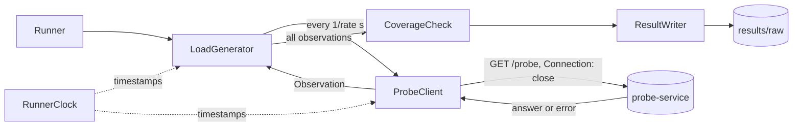

# Experiment runner

The experiment runner is the measuring instrument of the thesis. It sends requests
to the probe service at a constant rate, timestamps every answer on one clock,
checks that every replica was observed often enough, and saves every observation
to a file. The probe service is the object under study; the runner only observes it.

Status: stages 1 and 2 of 4 are done. The runner does not yet apply a configuration
change or detect the inconsistency window.

## Quick start

You need Java 21 or newer, Maven, and a running cluster with Way A or Way B on
port 30080 (see the [Way A runbook](runbook-way-a.md)).

Build once, and again after every code change:

```bash
cd tools/experiment-runner && mvn -q -DskipTests package && cd ../..
```

Run from the repository root, so the data lands in `results/raw/`:

```bash
java -jar tools/experiment-runner/target/experiment-runner.jar --duration 10 --label way-b
```

Expected output:

```
Probing http://localhost:30080/probe at 50 req/s for 10 s
Requests: 501 scheduled, 501 recorded, 501 ok, 0 failed
Per config version:
  v2                                         501
Latency ms: p50 3.9  p90 6.3  p99 17.8  max 85.1
Coverage per pod:
  probe-service-f664c8f55-5pswb              172  (34.3 %)  longest unobserved    219 ms
  probe-service-f664c8f55-cqg4t              151  (30.1 %)  longest unobserved    381 ms
  probe-service-f664c8f55-fgjvt              178  (35.5 %)  longest unobserved    239 ms
Run VALID
Saved /…/config-delivery-thesis/results/raw/20261025-005815_way-b.ndjson
```

## Arguments

| Argument | Default | Meaning |
|---|---|---|
| `--url` | `http://localhost:30080/probe` | Endpoint to observe |
| `--rate` | `50` | Requests started per second, on a fixed schedule |
| `--duration` | `10` | Seconds of load |
| `--replicas` | `3` | Number of replicas that must be observed |
| `--max-gap-ms` | `1000` | Longest allowed time a pod may go unobserved |
| `--label` | `test` | Free text that becomes part of the run id, for example `way-b` |
| `--out` | `results/raw` | Folder for the output files, relative to where you start the runner |

## Exit codes

| Code | Meaning |
|---|---|
| `0` | The run is valid |
| `2` | The run is invalid. Its files are still written, with `"valid": false` and the reasons |
| other | The runner itself failed, for example a wrong argument |

## Output files

Every run writes two files with the same run id: the local date and time of the
start, followed by the label.

```
results/raw/
├── 20261025-005815_way-b.ndjson      one line per request
└── 20261025-005815_way-b.meta.json   settings and verdict of the run
```

`results/raw/` is listed in `.gitignore` and is not committed. See
[results/README.md](../results/README.md).

### `<run id>.ndjson`

One JSON object per line, one line per request, ordered by `seq`:

```json
{"seq":0,"scheduledAt":193.188917,"sentAt":193.191,"receivedAt":278.25675,"status":200,"pod":"probe-service-f664c8f55-5pswb","configVersion":"v2","startedAt":1792269702999,"error":null}
```

| Field | Unit | Meaning |
|---|---|---|
| `seq` | | Request number, starting at 0. A missing number is a lost request |
| `scheduledAt` | ms since run start | When the request was due according to the fixed schedule |
| `sentAt` | ms since run start | When it was handed to the HTTP client |
| `receivedAt` | ms since run start | When the answer or the error arrived. The window is computed from this field |
| `status` | | HTTP status, or `0` when there was no answer |
| `pod` | | Replica that answered, from the response body |
| `configVersion` | | Configuration version that replica used |
| `startedAt` | epoch ms, pod clock | When that pod's process started. Changes on restart, stays on refresh |
| `error` | | `null`, or the kind of failure, for example `HttpTimeoutException` or `BadBody` |

All `…At` fields except `startedAt` come from the runner's clock. Add
`runStartedAtEpochMillis` from the meta file to turn them into absolute times.

### `<run id>.meta.json`

```json
{
  "runId" : "20261025-005815_way-b",
  "label" : "way-b",
  "runStartedAt" : "2026-10-24T22:58:15.424Z",
  "runStartedAtEpochMillis" : 1792882695424,
  "url" : "http://localhost:30080/probe",
  "ratePerSecond" : 50,
  "durationSeconds" : 10,
  "expectedReplicas" : 3,
  "maxGapMillis" : 1000.0,
  "scheduled" : 501,
  "recorded" : 501,
  "ok" : 501,
  "valid" : true,
  "problems" : [ ]
}
```

`runStartedAt` is in UTC, while the run id uses the local time of the machine. In
the example, 00:58 local time is 22:58 UTC.

## The coverage check

kube-proxy chooses a pod at random for each new connection, so a pod can go
unobserved for a while even when the overall shares look even. A version switch on
that pod would then be noticed late. The runner therefore checks, for each pod, the
longest time between two of its observations.

A run is invalid when:

- a pod went unobserved for longer than `--max-gap-ms`, or
- fewer pods than `--replicas` were observed at all.

Example of an invalid run, started with `--replicas 4` against three pods:

```
Run INVALID
  - only 3 of 4 replicas were observed
```

The gap is measured per pod and only between that pod's own observations, so pods
that appear or disappear during a Way A rollout do not make a run invalid on their
own. At 50 req/s and three replicas the longest gaps were between 219 and 460 ms in
the test runs. See [DECISIONS](../docs/DECISIONS.md) for the measurements behind the
default rate.

## How it works



| Class | Responsibility |
|---|---|
| `Runner` | Reads the arguments, wires the parts together, prints the summary, sets the exit code |
| `RunnerClock` | Reads the wall clock once at start, then advances with `System.nanoTime()`, so timestamps cannot jump during a run |
| `LoadGenerator` | Starts a request every 1/rate seconds with `scheduleAtFixedRate` and never waits for answers |
| `ProbeClient` | Sends one request with `sendAsync` and turns any outcome, including errors, into an `Observation` |
| `Observation` | One request and its answer |
| `CoverageCheck` | Computes the longest unobserved gap per pod and decides whether the run is valid |
| `RunResult` | Settings and verdict of a run, written as the meta file |
| `ResultWriter` | Writes the NDJSON and the meta file |

Three choices make the numbers trustworthy:

- Requests follow a fixed schedule and never wait for earlier answers, and latency
  is measured from the scheduled time. A slow system cannot slow down its own
  measurement (no coordinated omission).
- Every request opens a new connection (`Connection: close` over HTTP/1.1), because
  kube-proxy only chooses a pod when a connection opens. Without it, 300 of 301
  requests in a test reached the same pod.
- There is one clock, in one process, outside the cluster.

The runner is plain Java 21 with Jackson as its only dependency. The shade plugin
packs both into `target/experiment-runner.jar`.

## Known limitations

| Limitation | Effect |
|---|---|
| The first seconds of a run include the runner's own JVM warm-up | Higher latency at the start (p99 777 ms in a 10 s test, 15 ms in a 30 s test). A warm-up phase before the change is planned for stage 3 |
| A replica is only observed when a request reaches it | Any measured window is a lower bound, off by at most the longest gap |
| Observations are kept in memory until the end | Fine for runs of minutes; not meant for hours |

## Planned stages

| Stage | Adds |
|---|---|
| 3 | Warm-up phase, then the runner applies the configuration change itself and records its time |
| 4 | Window detection from the observations (first new version, last old version, stale answers), with unit tests |
